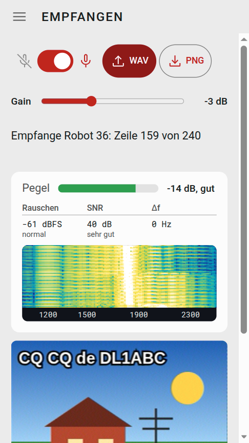
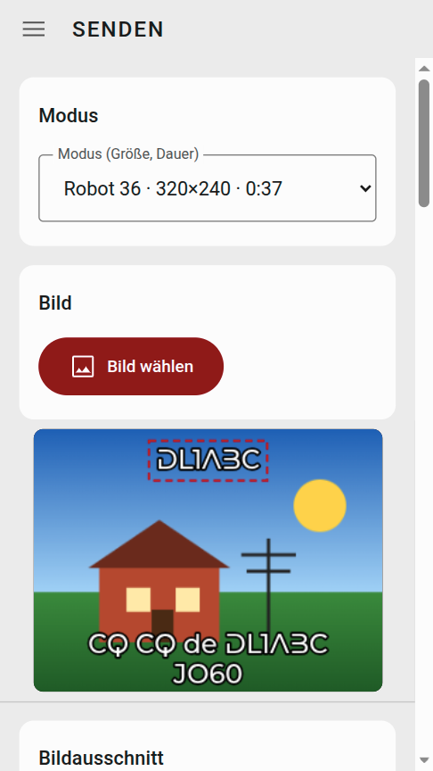
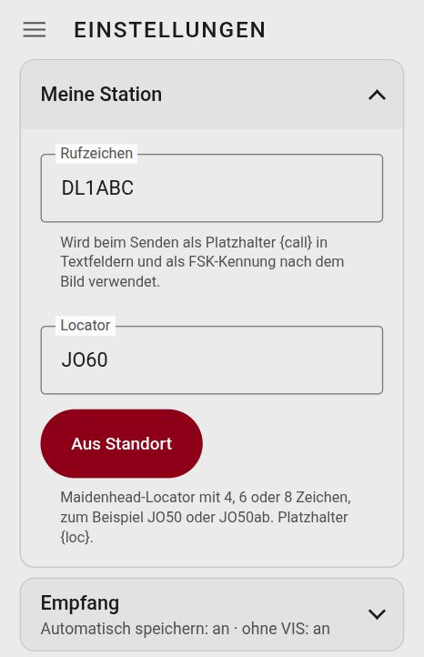
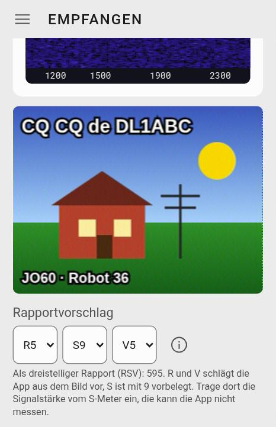
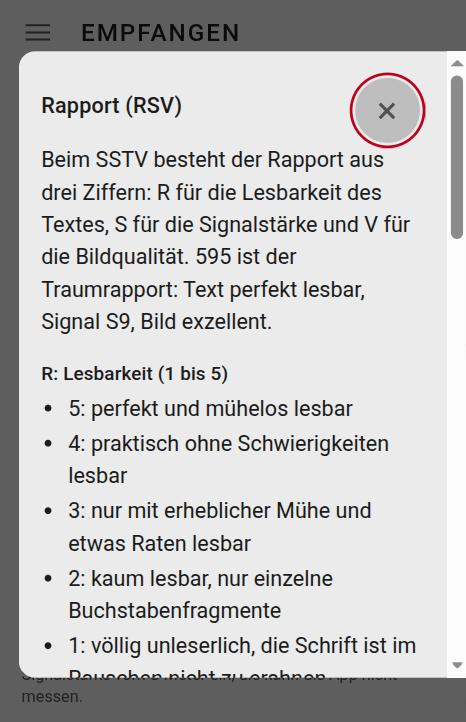
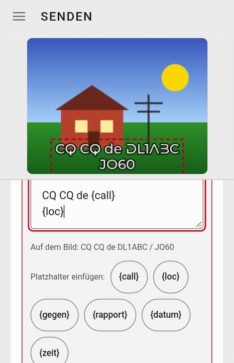
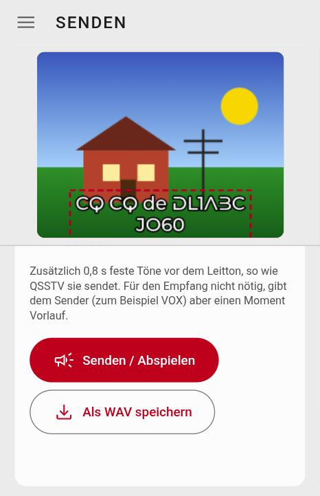
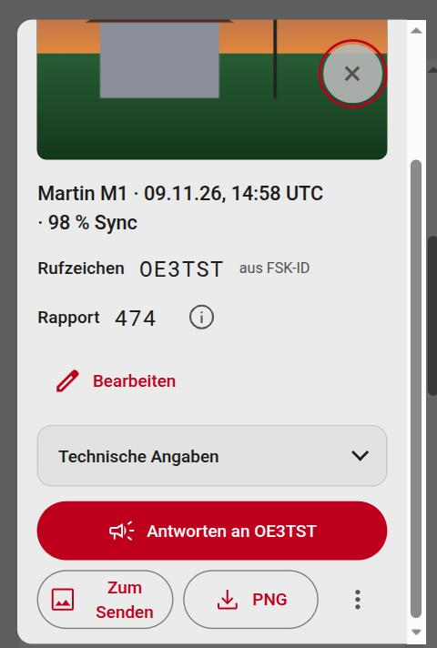
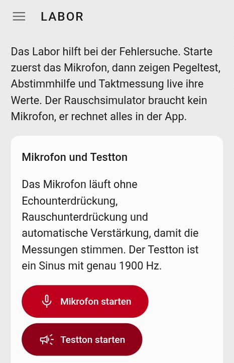
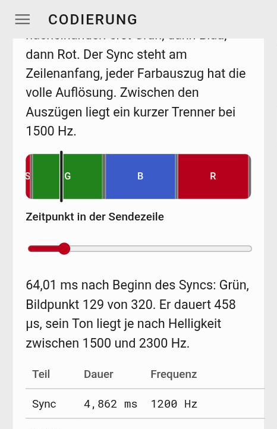

# SSTV-Horch: die Anleitung

*Bedienungsanleitung für eine App, die Bilder in Töne verwandelt und wieder zurück.*

## Worum es geht

SSTV (Slow Scan Television) schickt Standbilder als Ton über Funk. Das Bild wird Zeile für Zeile in eine Tonfrequenz umgesetzt: 1500 Hz bedeuten schwarz, 2300 Hz weiß, dazwischen liegen die Grautöne und Farben. Zwischen den Zeilen kommt ein kurzer Taktton bei 1200 Hz, an dem der Empfänger erkennt, wo eine Zeile anfängt. Ein Bild dauert je nach Modus von gut einer halben Minute bis zu etwa viereinhalb Minuten.

Weil das Signal nur Töne im Sprachbereich braucht, passt es durch jedes Sprachfunkgerät. Man hört es auf Kurzwelle und UKW, und die Internationale Raumstation schickt zu bestimmten Terminen solche Bilder zur Erde.

**SSTV-Horch** macht beides im Browser:

- **Empfangen:** Töne aus dem Mikrofon, aus einer WAV-Datei oder aus einem WebSDR werden wieder zu einem Bild. Die App erkennt den Modus selbst, auch wenn der Anfang der Aussendung fehlt.
- **Senden:** Ein Bild, eine Kamera-Aufnahme oder ein Foto aus der Galerie wird zugeschnitten, mit Text versehen und als SSTV-Signal abgespielt oder als WAV-Datei gespeichert.
- **Dazu:** eine Galerie für alles, was du empfangen hast, ein kleines Logbuch, ein Labor zum Messen und Ausprobieren und eine Seite, die erklärt, wie das Signal aufgebaut ist.

Dreizehn Modi sind eingebaut, vom schnellen Robot 36 (36 Sekunden) bis zum langsamen Scottie DX (gut viereinhalb Minuten). Alles läuft auf deinem Gerät. Es gibt kein Konto, nichts wird hochgeladen, und nach dem ersten Laden geht die App auch ohne Netz.

## Wie es dazu kam

SSTV-Horch ist die Schwester von [FT8-Horch](https://ohrenbeisser.de/app/FT8-horch/) und bedient sich ähnlich: ein Menü oben links, die Bereiche darin, helles und dunkles Aussehen, Deutsch und Englisch.

Die Physik, die Modi und die Fehlersuche stehen im Artikel [SSTV – Fernsehen im Schneckentempo](https://ohrenbeisser.de/sstv-fernsehen-im-schneckentempo/). Die App ist das Gegenstück dazu: Was dort erklärt ist (der Zeilenaufbau, die Kennung am Anfang, die Frequenzen), kannst du hier anhören, verändern und mit eigenen Bildern ausprobieren. Der Bereich **Codierung** ist genau dafür da.

## So benutzt du diese Anleitung

- **Eilig?** Das nächste Kapitel, „Das Wichtigste in drei Minuten“, bringt dich zum ersten empfangenen und zum ersten gesendeten Bild.
- **Nachschlagen:** Die Kapitel folgen den Punkten im Menü (Empfangen, Senden, Galerie, WebSDR, Labor, Codierung). Am Ende stehen eine Tabelle „Wenn nichts geht“ und ein kleines Wörterbuch.
- **Die Beispiele** verwenden erfundene Rufzeichen wie `DL1ABC`.

## Das Wichtigste in drei Minuten

Du hast keine Lust auf Handbücher? Verständlich. Hier die Kurzfassung, erst fürs Empfangen, dann fürs Senden.

### Ein Bild empfangen

1. Oben links das Menü (☰) öffnen, **Einstellungen** wählen und dein Rufzeichen und deinen Locator eintragen (zum Beispiel `DL1ABC` und `JO60`). Für das Empfangen brauchst du das noch nicht, fürs Senden und das Logbuch ist es später praktisch.
2. Im Menü **Empfangen** öffnen. Den **Mikrofon-Schalter** (links Mikrofon durchgestrichen, rechts Mikrofon) nach rechts schieben und die Frage nach dem Mikrofon mit „Zulassen“ beantworten.
3. Eine SSTV-Aussendung hörbar machen: aus dem Lautsprecher eines Funkgeräts oder Empfängers, aus einem WebSDR oder von einem zweiten Gerät mit SSTV-Horch. Das Mikrofon sollte etwa 20 bis 50 cm vom Lautsprecher entfernt sein. Der **Pegel**-Balken zeigt, wie laut es ankommt: Grün heißt gut, Gelb zu leise oder zu hoch, Rot übersteuert. Das Wort steht jeweils daneben.
4. Sobald die Kennung am Anfang erkannt ist, steht oben zum Beispiel „Empfange Robot 36: Zeile 159 von 240“, und das Bild wächst Zeile für Zeile. Am Ende steht „fertig“ und „In der Galerie gespeichert“. Hat der Sender sein Rufzeichen mitgeschickt (FSK-Kennung), zeigt die App es an.
5. Unter dem Bild schlägt die App einen **Rapport** vor: R (Lesbarkeit) und V (Bildqualität) aus dem Bild, S (Signalstärke) mit 9 vorbelegt. Ändern kannst du alle drei.

### Ein Bild senden

1. Im Menü **Senden** öffnen und oben den **Modus** wählen. Für den Anfang eignet sich Robot 36: 37 Sekunden, 320 × 240 Bildpunkte.
2. **Bild wählen** drücken (am Handy auch **Foto aufnehmen**). Das Bild erscheint im Rahmen. Mit einem Finger verschiebst du es, mit zwei Fingern zoomst du.
3. Mit der Schnellwahl **Rufzeichen** und **CQ-Ruf** legst du Textfelder ins Bild. Mit dem Finger ziehst du sie an die richtige Stelle.
4. Weiter unten stellst du den **Ausgabepegel** ein und drückst **Senden / Abspielen**. Eine rote Linie wandert über die Vorschau und zeigt, wie weit das Bild ist. Stell die Lautstärke am Gerät so ein, dass der Sender nicht übersteuert.

### Ohne Funk ausprobieren

Du brauchst kein Funkgerät, um zu sehen, ob alles läuft:

- **Mit einer Datei:** In **Senden** auf **Als WAV speichern** drücken. Danach in **Empfangen** **WAV laden** wählen und die Datei öffnen. Die App decodiert ihr eigenes Signal in wenigen Sekunden.
- **Mit zwei Geräten:** Ein Gerät sendet, das andere hört mit dem Mikrofon zu. Mehr dazu in einem späteren Kapitel.

## Was SSTV-Horch kann (und was lieber nicht)

### Die Bereiche im Menü

| Bereich | Wofür |
|---|---|
| **Empfangen** | SSTV hören und als Bild sehen: Mikrofon, WAV-Datei oder WebSDR-Ton, mit Wasserfall, Pegel und Rapportvorschlag |
| **Senden** | Bild wählen, zuschneiden, beschriften, als Ton abspielen oder als WAV speichern |
| **Galerie** | alles Empfangene, mit Filter, Rufzeichen und Rapport, Sicherung als ZIP, dazu das Logbuch |
| **WebSDR (Beta)** | Server im Netz, deren Ton die App wie ein Mikrofon abhören kann |
| **Codierung** | drei Karten, die zeigen und hörbar machen, wie das Signal gebaut ist |
| **Labor** | Pegeltest, Abstimmhilfe, Taktmessung, Rauschsimulator |
| **Einstellungen, Hilfe, Über** | Station, Audiogeräte, Sprache und Aussehen, diese Anleitung, Lizenz und Datenschutz |

### Die dreizehn Modi

SSTV-Horch kennt diese Modi, zum Senden und zum Empfangen:

| Modus | Bildgröße | Dauer (mit Vorspann) | VIS |
|---|---|---|---|
| Robot 36 | 320 × 240 | 0:37 | 8 |
| Robot 72 | 320 × 240 | 1:13 | 12 |
| Martin M1 | 320 × 256 | 1:55 | 44 |
| Martin M2 | 320 × 256 | 0:59 | 40 |
| Scottie S1 | 320 × 256 | 1:51 | 60 |
| Scottie S2 | 320 × 256 | 1:12 | 56 |
| Scottie DX | 320 × 256 | 4:30 | 76 |
| PD90 | 320 × 256 | 1:31 | 99 |
| PD120 | 640 × 496 | 2:07 | 95 |
| PD160 | 512 × 400 | 2:42 | 98 |
| PD180 | 640 × 496 | 3:08 | 96 |
| PD240 | 640 × 496 | 4:09 | 97 |
| Wraase SC2-180 | 320 × 256 | 3:03 | 55 |

Die **VIS-Nummer** ist die Kennung, mit der ein Sender den Modus ankündigt. Mehr dazu im Kapitel „Codierung“.

Wofür sich welcher Modus eignet:

- **Robot 36** ist der schnelle Einstieg und auf 2 m (FM) und bei der ISS zu Hause. Auf Kurzwelle ist er wegen Abstimmfehlern anfälliger. Robot 72 braucht doppelt so lang, jede Zeile trägt dabei ihre eigene Farbinformation.
- **Martin M1** gilt laut SSTV-Handbook als beliebtester Modus auf Kurzwelle. **Martin M2** ist halb so lang und hilft bei unruhigen Bändern.
- **Scottie DX** ist für Fernverbindungen gedacht und dauert gut viereinhalb Minuten. **Scottie S2** ist die schnelle Variante, S1 liegt dazwischen.
- **PD90 bis PD240** sind die Modi mit hoher Auflösung (PD120, PD180 und PD240 mit 640 × 496 Bildpunkten). Zwei Bildzeilen teilen sich dabei die Farbinformation. PD120 sendet auch die ISS manchmal.
- **Wraase SC2-180** ist ein RGB-Modus mit drei Farbkanälen je Zeile, ohne Trennzeichen dazwischen.

### Was die App von allein erledigt

- **Modus erkennen:** am VIS-Code am Anfang. Fehlt er (Anfang verpasst, im Rauschen verloren), sucht die App den Takt der Zeilen. Schnelle Modi erkennt sie nach wenigen Sekunden, Scottie DX und PD180 brauchen 20 bis 25 Sekunden.
- **Frequenzversatz ausgleichen**, auch wenn er sich während des Bildes verschiebt.
- **Taktfehler der Soundkarte ausgleichen**, sonst steht das Bild schief.
- **Rufzeichen lesen**, wenn der Sender es als FSK-Kennung nach dem Bild schickt.
- **Teilbilder** werden gespeichert und gekennzeichnet, wenn ein Bild abbricht.

### Was lieber nicht

- **Kein iPhone und kein iPad.** Die App ist für Android mit Chrome und für den Computer gebaut.
- **Nur analoges SSTV.** Digitale Bildmodi wie DSSTV (HamDRM) kann die App nicht.
- **Keine Funkgerätesteuerung.** Es gibt kein CAT und keine PTT-Schaltung. Zum Senden schaltest du per VOX oder von Hand um.
- **Kein Überflugrechner.** Wann die ISS über dich fliegt, sagen dir andere Werkzeuge. Zum Doppler steht ein Hinweis im Kapitel „WebSDR (Beta)“.
- **Das S-Meter kann sie nicht lesen.** Die App hört nur den Ton hinter dem Empfänger, nicht die Feldstärke an der Antenne. Deshalb ist S im Rapport mit 9 vorbelegt, und du trägst den Wert ein.
- **Ein guter Rauschabstand (SNR) ist keine Garantie für ein gutes Bild.** Er misst nur Signal gegen Rauschen. Verzerrung und Echo, zum Beispiel über Lautsprecher und Mikrofon, sieht er nicht.
- **Ohne VIS ist der Bildanfang geschätzt.** Du kannst ihn in der Galerie von Hand verschieben. Bei sehr starkem Frequenzversatz (über etwa ±140 Hz) findet die App ohne VIS den Takt nicht.
- **Der Ton eines Browser-Tabs** (für WebSDR) geht nur in Chrome und Edge am Computer.
- **Senden über Funk** setzt eine Amateurfunkgenehmigung voraus. Zum Üben reichen eine Datei, ein Kabel oder Lautsprecher und Mikrofon.

### Wo die App läuft

| Gerät | Stand |
|---|---|
| Android mit Chrome | getestet (Pixel 10a) |
| Linux-Computer mit Chrome | getestet |
| Windows und Mac mit Chrome oder Edge | nicht eigens getestet, sollte gehen |
| Firefox am Computer | nicht getestet, ohne Tab-Ton |
| iPhone und iPad | nicht vorgesehen |

Das Mikrofon und die Installation als App verlangen eine **sichere Verbindung** (HTTPS). Über die Internetadresse der App ist das gegeben.

## Erste Schritte

### Rufzeichen und Locator

Menü (☰), **Einstellungen**, Abschnitt **Meine Station**. Dort trägst du dein **Rufzeichen** und deinen **Locator** ein.

- Das **Rufzeichen** setzt die App für den Platzhalter `{call}` in Textfeldern ein und sendet es auf Wunsch als FSK-Kennung nach dem Bild. Erlaubt sind Buchstaben, Ziffern und der Schrägstrich, 3 bis 12 Zeichen. Die App warnt nur, wenn es nicht wie ein Rufzeichen aussieht, sie sperrt nichts.
- Der **Locator** (Maidenhead, 4, 6 oder 8 Zeichen, zum Beispiel `JO50` oder `JO50ab`) steht für den Platzhalter `{loc}`. Der Knopf **Aus Standort** rechnet ihn aus der Position deines Geräts aus. Dafür fragt der Browser nach der Ortungserlaubnis. Die Position selbst speichert die App nicht.

### Audiogeräte

Im Abschnitt **Audiogeräte** wählst du, welches Mikrofon (oder welchen Audioeingang) und welchen Lautsprecher (oder Audioausgang) die App benutzt. Die Auswahl gilt für Empfangen, Senden, Labor und die Hörproben.

1. Drücke **Geräte anzeigen**. Der Browser zeigt die Namen der Geräte erst, wenn du den Mikrofonzugriff einmal erlaubt hast. Die App gibt das Mikrofon dabei sofort wieder frei.
2. Wähle den Eingang und den Ausgang. Eine **USB-Soundkarte** oder ein **virtuelles Audiokabel** erscheint hier als Gerät. Ein Funkgerät mit Soundkarte oder ein zweites Programm auf demselben Computer lässt sich so anschließen.
3. Fehlt das gewählte Gerät später, nimmt die App das Standardgerät des Systems.

Firefox kann den Ausgang nicht umschalten. Dort stellst du ihn im System ein.

Beim Aufnehmen schaltet die App Echo-Unterdrückung, Rauschunterdrückung und die automatische Verstärkung des Mikrofons selbst aus. Sie würden die Töne verfälschen, auf denen das Bild beruht.

### Die Zeitanzeige

Anders als bei Betriebsarten mit festen Zeitfenstern muss die Uhr bei SSTV nicht auf die Sekunde stimmen. Sie bestimmt nur, wie Zeiten erscheinen. Im Abschnitt **Sprache, Darstellung und Zeit** wählst du bei **Zeitanzeige** zwischen **Ortszeit** und **UTC (Weltzeit)**. Das gilt für die Galerie, die Dateinamen und die Platzhalter `{datum}` und `{zeit}`. Bei UTC steht „UTC“ dabei. Das Logbuch führt die Zeit immer in UTC.

Dort stellst du auch die **Sprache** (Deutsch oder Englisch) und das **Aussehen** (**Hell**, **Dunkel** oder **System**) ein.

### Daten sichern

Alles, was die App speichert, bleibt auf deinem Gerät: Bilder und Logbuch im Speicher des Browsers, Einstellungen daneben. Löschst du die Browserdaten, ist es weg. Deshalb:

- In der **Galerie** erzeugt **Sicherung (ZIP)** eine Datei mit allen Bildern, ihrem Rufzeichen und Rapport, den Rohaufnahmen und dem Logbuch. **Sicherung einlesen** holt sie zurück. Was schon da ist, überspringt die App. Die Einstellungen sind nicht in der Sicherung.
- Unten in der Galerie zeigt die Karte **Speicher**, wie viel Platz die Bilder belegen. Ist der Speicher nicht dauerhaft, darf der Browser ihn bei Platzmangel räumen. **Dauerhaften Speicher erbitten** bittet den Browser darum.

### Als App auf den Startbildschirm

SSTV-Horch lässt sich wie eine App installieren. Sie startet dann in einem eigenen Fenster und läuft auch ohne Netz.

- Ab dem dritten Start fragt ein Band am oberen Rand, ob du installieren willst (**Installieren** oder **Nicht jetzt**). Du kannst es auch jederzeit in den Einstellungen im Abschnitt **Installation** tun.
- Geht der Knopf nicht, steht im Browsermenü „App installieren“ oder „Zum Startbildschirm hinzufügen“.
- Installieren geht nur über eine sichere Verbindung (HTTPS).

Kommt eine neue Fassung der App, lädt sie sich von selbst neu. Läuft gerade ein Empfang oder eine Wiedergabe, wartet sie damit, bis beides vorbei ist.

## Empfangen

### Mikrofon, Gain und Pegel

Oben im Bereich **Empfangen** sitzen der **Mikrofon-Schalter**, **WAV** (eine WAV-Datei laden), **PNG** (das Bild speichern) und der **Gain**-Regler. Auf schmalen Anzeigen rutscht der Gain unter die Knöpfe.

- **Mikrofon-Schalter:** rechts ist an. Solange er aus ist, liegt ein Schleier über der Messkarte, denn dann gibt es nichts zu messen.
- **Gain** verstärkt in der App, von −20 bis +30 dB. Er wirkt hinter dem Mikrofon und kann eine Übersteuerung davor nicht rückgängig machen. Stell zuerst die Lautstärke an der Quelle richtig ein, den Gain nimmst du nur zum Feinabgleich.
- Der **Pegel**-Balken zeigt die Spitze des Signals in dB und ein Wort dazu:
  - **zu leise** (gelb): Spitze unter etwa −30 dB. Lauter stellen oder Gain anheben.
  - **gut** (grün): zwischen etwa −30 und −6 dB. Ziel sind Spitzen um −20 bis −6 dB.
  - **hoch** (gelb): zwischen −6 dB und knapp unter 0 dB. Noch ohne Abschneiden, aber wenig Reserve. Einen Schritt leiser stellen.
  - **übersteuert** (rot): die Spitze erreicht die Grenze (0 dB), das Signal wird abgeschnitten. Leiser stellen.
- Solange das Mikrofon läuft, bleibt der Bildschirm an. Wechselst du kurz in einen anderen Bereich, läuft der Empfang weiter und nichts geht verloren.

### Messwerte und Wasserfall

Unter dem Pegel stehen drei Messwerte:

| Wert | Bedeutung |
|---|---|
| **Rauschen** | Grundrauschen in dBFS: unter −70 „sehr ruhig“, bis −55 „normal“, darüber „laut“ |
| **SNR** | Rauschabstand im Tonband: ab 30 dB „sehr gut“, ab 20 „gut“, ab 12 „Bild wird körnig“, ab 6 „sehr schwach“, darunter „kein Signal“ |
| **Δf** | Frequenzversatz in Hz. Die App gleicht ihn aus. Ab etwa 40 Hz steht „groß“ daneben: Dann ist der Empfänger zu weit daneben abgestimmt |

Das Grundrauschen ist der leiseste Wert der letzten 90 Sekunden. Während ein Bild läuft, kommt keine neue Messung dazu, so bleibt der Wert von vor dem Bild stehen. Bewegst du den Gain, fängt die Messung neu an.

Der **Wasserfall** zeigt Frequenz nach rechts (1000 bis 2500 Hz) und die Zeit nach unten. Die Marken bedeuten: 1200 Hz Takt (Sync), 1500 Hz Schwarz, 1900 Hz Leitton, 2300 Hz Weiß. Rauschen bleibt dunkelblau. Vor einem Bild siehst du den Leitton als hellen senkrechten Strich bei 1900 Hz, ein Bild selbst füllt das ganze Band zwischen 1500 und 2300 Hz.

### Wie die App ein Bild erkennt

- **Mit Kennung:** Ein SSTV-Bild beginnt mit einem Leitton und der **VIS-Kennung**, die den Modus verrät. Hat die App sie gehört, steht oben „Empfange Robot 36: Zeile 159 von 240“.
- **Ohne Kennung:** Fehlt der Anfang, sucht die App den Takt der Zeilen. Schnelle Modi erkennt sie nach wenigen Sekunden, langsame wie Scottie DX und PD180 brauchen 20 bis 25 Sekunden. Dann steht zusätzlich „Ohne Kennung (VIS) am Takt erkannt, der Bildanfang kann verschoben sein“. Die Funktion lässt sich in den Einstellungen im Abschnitt **Empfang** abschalten (**Bilder ohne Kennung (VIS) erkennen**). Sie kostet etwas Rechenzeit und rund 6 MB Speicher.
- **Verworfen:** Findet die App eine Kennung, aber danach kein brauchbares Signal, steht „Kennung für … gefunden, aber kein brauchbares Signal. Verworfen.“
- **Unvollständig:** Bricht ein Bild ab oder schaltest du das Mikrofon aus, speichert die App das Teilbild und schreibt „unvollständig: 120 von 240 Zeilen“.
- **Rufzeichen:** Schickt der Sender nach dem Bild eine FSK-Kennung, liest die App sie und schreibt „Rufzeichen (FSK-ID): DL1ABC“. Stimmt die Prüfsumme nicht, steht ein Fragezeichen dahinter, und die App trägt das Rufzeichen nicht ein.

### Das fertige Bild

Ist das Bild fertig, steht „fertig“ und „In der Galerie gespeichert“. Das Speichern ist in den Einstellungen im Abschnitt **Empfang** ein Schalter (**Empfangene Bilder automatisch speichern**). Tippst du auf das Bild, füllt es den Bildschirm, ein zweiter Tipp bringt dich zurück. **PNG** speichert es als Datei.

Robot 36 und die PD-Modi senden Helligkeit und Farbe im „Studiobereich“. Andere Decoder zeigen sie flauer, mit grauem statt schwarzem Schwarz. Der Schalter **Kompatible Helligkeit** in den Einstellungen zeigt sie auch so, zum Vergleich mit anderen Programmen. Er wirkt ab dem nächsten Empfang und nur bei Robot 36 und den PD-Modi. Gespeicherte Bilder bleiben unverändert.

### Der Rapportvorschlag

Unter dem Bild steht der **Rapportvorschlag** mit drei Auswahlfeldern. Im SSTV-Rapport sind das drei Ziffern, im Beispiel 595:

- **R** ist die Lesbarkeit des Textes (1 bis 5),
- **S** die Signalstärke (1 bis 9),
- **V** die Bildqualität (1 bis 5).

Die App misst nach dem Bild, wie stark es rauscht, und leitet daraus **R und V** ab. Fehlen viele Zeilen, sinken beide Werte. **S** kennt sie nicht, denn die Feldstärke an der Antenne sieht nur das S-Meter des Empfängers. Deshalb steht S auf 9, und du trägst den Wert ein, den du abliest. Alle drei Felder kannst du ändern. Die Änderung wandert in die Galerie.

Der Vorschlag ist eine Näherung. Ein Foto mit feiner Struktur gilt schnell als verrauscht, Schiefstand und Farbfehler sieht die Messung nicht. Entscheiden tust du. Das **(i)** neben den Feldern öffnet eine Erklärung mit den Stufen für R, S und V.

### Rohaufnahme und andere Quellen

- **Rohaufnahme:** Mit dem Schalter **Rohaufnahme der empfangenen Bilder mitspeichern** (Einstellungen, Abschnitt **Empfang**) hängt die App an jedes Bild, das über das Mikrofon kommt, die Aufnahme dazu (12 kHz, 16 Bit, mit etwas Vorlauf). In der Galerie speicherst du sie mit **Roh-WAV**. Damit kannst du das Bild später noch einmal decodieren, in **Empfangen** über **WAV** oder mit einem anderen Programm. Robot 36 braucht dafür rund 1 MB.
- **WAV-Datei:** **WAV** liest eine Datei schneller als in Echtzeit und zeigt das Bild. Das eignet sich für Aufnahmen und zum Ausprobieren.
- **Browser-Tab:** Den Ton eines WebSDR im Browser übernimmt die Seite **WebSDR (Beta)**. Dort steht auch, wie es geht.

### Tipps für gute Bilder

- **Pegel grün:** Beobachte den Balken beim Leitton, nicht mitten im Bild.
- **Abstand und Lautstärke:** Über Lautsprecher und Mikrofon stehen beide etwa 20 bis 50 cm auseinander, der Lautsprecher nicht auf voller Lautstärke. Ein Kabel ist besser (Kapitel „Über Lautsprecher und Mikrofon, mit Kabel oder mit dem Funkgerät“).
- **Ruhiger Raum:** Gespräche und Geräusche stören das Band. Der Wasserfall zeigt es.
- **App im Vordergrund lassen** und den Bildschirm anlassen. Die App hält ihn selbst an, solange das Mikrofon läuft.
- **Schiefes Bild, falsche Farben, Rauschen:** Das Kapitel „Wenn nichts geht“ erklärt, woran es liegt.

## Senden

### Der Aufbau des Bereichs

Der Bereich **Senden** besteht von oben nach unten aus diesen Teilen: **Modus**, **Bild**, **Bildausschnitt**, **Beschriftung** (mit den **Angaben für deine Texte**), **Vorlagen** und zuletzt **Senden**. Die **Vorschau** des Sendebildes bleibt beim Scrollen oben stehen und nimmt höchstens ein Drittel der Höhe ein. So siehst du immer, was du bearbeitest.

### Modus und Bild

- **Modus (Größe, Dauer):** Die Liste nennt zu jedem Modus die Bildgröße und die Dauer, zum Beispiel „Robot 36 · 320×240 · 0:37“. Der Rahmen in der Vorschau passt sich an.
- **Bild wählen** öffnet eine Datei oder ein Foto aus der Galerie deines Geräts. **Foto aufnehmen** gibt es nur auf Geräten mit Kamera und öffnet die Kamera-App. Ein Bild aus der Galerie von SSTV-Horch schickst du über **Zum Senden** im Bild-Dialog hierher.

### Der Bildausschnitt

Das Bild füllt den Rahmen des Modus nur, wenn die Seitenverhältnisse passen. Sonst entscheidest du:

- **Füllen** schneidet das Bild zu, so dass es den Rahmen ganz ausfüllt.
- **Einpassen** zeigt das ganze Bild und füllt den Rest mit **Balken** in Schwarz, Grau oder Weiß.
- Mit **einem Finger** verschiebst du das Bild im Rahmen, mit **zwei Fingern** oder dem Mausrad zoomst du. Der Regler **Zoom** macht dasselbe.

### Texte ins Bild

Unter **Beschriftung** legst du Textfelder aufs Bild. Die **Schnellwahl** erzeugt sie auf Knopfdruck:

| Knopf | Text |
|---|---|
| **+ Textfeld** | ein leeres Feld |
| **Rufzeichen** | `{call}` |
| **CQ-Ruf** | `CQ CQ de {call}` und in der zweiten Zeile `{loc}` |
| **QSO** | `{gegen} de {call}` und `UR RSV {rapport}` |
| **Locator** | `{loc}` |
| **Datum und Zeit** | `{datum}  {zeit}` |

Die Platzhalter in den geschweiften Klammern setzt die App beim Senden ein: `{call}` und `{loc}` aus den Einstellungen, `{gegen}` und `{rapport}` aus den **Angaben für deine Texte** (Rufzeichen der Gegenstelle und der Rapport, den du ihr gibst), `{datum}` und `{zeit}` aus der Uhr. Ein Fragezeichen im Rapport steht für das S, das du selbst einträgst.

- Ein Textfeld verschiebst du im Bild mit dem Finger.
- Tippst du in der Liste **Texte auf dem Bild** auf einen Text, öffnet sich der **Editor**. Dort ändern sich der Text selbst, die **Schrift** (drei Schriften sind in der App enthalten, dazu drei Systemschriften), die **Schriftgröße**, die **Farbe** (Weiß, Gelb, Rot, Schwarz) und die **Kontur**. Die Knöpfe unter **Platzhalter einfügen** setzen `{call}` und die anderen an die Schreibmarke. Die Zeile „Auf dem Bild:“ zeigt, wie der Text nach dem Einsetzen aussieht.
- Ein Feld löschst du mit dem Papierkorb. **Rückgängig** holt es zurück.

### Vorlagen

Eine **Vorlage** merkt sich Anordnung, Größe, Farbe und Schrift aller Texte samt Platzhaltern, nicht das Bild. Das spart Arbeit, wenn du oft dasselbe Layout brauchst.

- **Speichern:** Namen eintragen (bis 40 Zeichen) und **Speichern** drücken. Ein vorhandener Name wird überschrieben. Es sind höchstens 20 Vorlagen möglich. Ohne Text auf dem Bild gibt es nichts zu speichern.
- **Laden** holt eine Vorlage auf das Bild, **Löschen** entfernt sie. Beides lässt sich mit **Rückgängig** zurücknehmen.

### Senden

Der Teil **Senden** am Ende hat diese Einstellungen:

- **Ausgabepegel:** Der Regler senkt die Lautstärke des Signals weiter ab. Das Signal selbst hat immer Reserve (höchstens 80 % der Vollaussteuerung), damit Endstufe und Pegelregelung des Senders nicht gegen die Wand laufen. Stell die Lautstärke am Gerät so ein, dass der Sender nicht übersteuert. Der Pegel lässt sich auch während der Wiedergabe ändern.
- **Rufzeichen als FSK-ID nach dem Bild senden:** Nach dem Bild folgt dein Rufzeichen als kurze Tonfolge (etwa 2 Sekunden zusätzlich). Empfänger wie QSSTV und SSTV-Horch lesen es aus. Dafür muss in den Einstellungen dein Rufzeichen stehen.
- **Kalibrierkopf vor dem Leitton senden:** Zusätzlich 0,8 Sekunden feste Töne vor dem Leitton, wie QSSTV sie sendet. Der Empfang braucht sie nicht, aber dem Sender (zum Beispiel bei VOX) geben sie einen Moment Vorlauf.
- **Taktkorrektur dieses Geräts:** Hast du im Labor die Taktabweichung deiner Soundkarte gemessen und in den Einstellungen eingetragen, rechnet die App beim Abspielen damit. Bei WAV-Dateien nicht, denn die können auf einem anderen Gerät laufen.

Dann drückst du **Senden / Abspielen**. Die App berechnet das Signal („Berechne das Signal …“) und spielt es ab. Die Statuszeile zeigt „Sendet: 0:12, noch 0:25 Zeile 80 von 240“, und eine **rote Linie** wandert über die Vorschau und zeigt, wie weit das Bild ist. **Stopp** bricht ab. Während der Wiedergabe bleibt der Bildschirm an. Den Ausgang wählst du in den Einstellungen unter **Audiogeräte**.

### Als WAV speichern

**Als WAV speichern** erzeugt dasselbe Signal als Datei (`sstv_robot36_…wav`), mit dem eingestellten Ausgabepegel. Damit kannst du ein Bild vorbereiten, die Datei auf ein anderes Gerät oder in ein Funkprogramm bringen und sie später senden. Zum Ausprobieren lädst du sie in **Empfangen** über **WAV**.

## Galerie und Logbuch

### Das Raster

Alles, was du empfängst, landet in der **Galerie**, auch Teilbilder (mit gestricheltem Rand und „Teilbild 154/256“). Jede Kachel zeigt die Vorschau, den Modus, die Zeit und die Güte des Empfangs (Anteil der Zeilen mit Sync-Treffer, zum Beispiel „98 %“).

, gefiltert nach „TST“. Das vierte Bild ist ein Teilbild.")

- **Filter:** **Suche** nach Rufzeichen oder Modus, **Modus** und **Zeitraum** (Alle, Heute, Letzte 7 Tage, Letzte 30 Tage). Darüber steht „4 von 20 Bildern“, **Filter zurücksetzen** holt alles zurück.
- **Auswählen** schaltet die Auswahl ein. Du tippst Bilder an, **Alle** und **Keine** wählen die gerade angezeigten, **Löschen** fragt noch einmal nach („3 endgültig löschen?“), und **Auswahl sichern (ZIP)** sichert nur diese Bilder.

### Das Bild im Detail

Tippst du eine Kachel an, öffnet sich das Bild. Oben stehen Modus, Zeit und die Güte des Empfangs, darunter **Rufzeichen** und **Rapport** als Text.

- **Rufzeichen:** Daneben steht, woher es kommt: „aus FSK-ID“ oder „eigener Eintrag“. Das **(i)** neben dem Rapport erklärt die Stufen.
- **Bearbeiten** öffnet das Eingabefeld für das Rufzeichen und die drei Auswahlfelder für R, S und V. **Speichern** übernimmt, **Abbrechen** verwirft, die Eingabetaste speichert auch. Ein von dir geändertes Rufzeichen gilt als „eigener Eintrag“.
- **Technische Angaben** (zugeklappt): Modus mit VIS-Nummer oder „ohne VIS erkannt“, Zeilen, Verschiebung, Rohaufnahme, Quelle (Mikrofon, WAV-Datei, Browser-Tab, Sicherung) und Größe.
- **Antworten an …** gibt es, sobald ein Rufzeichen da ist. Der Knopf springt nach **Senden**, trägt die Gegenstelle und den Rapport ein, wählt den Modus vor und legt einen QSO-Text an. Das Bild suchst du dir selbst aus.
- **Zum Senden** schickt dieses Bild als Sendebild nach **Senden**. **PNG** speichert es als Datei, **Roh-WAV** die Rohaufnahme (wenn es eine gibt).
- Das Menü **⋮** bietet **Teilen** (das Teilen-Menü des Geräts), **Ins Log übernehmen** und **Löschen** (mit zweitem Tipp „Wirklich löschen?“).

**Bildanfang verschieben** erscheint bei Bildern, die ohne VIS erkannt wurden. Dort ist der Anfang nur geschätzt: Die erste gehörte Zeile gilt als oberste. Mit dem Regler (und den Knöpfen −10, −1, +1, +10) schiebst du das Bild nach unten (positive Werte, oben bleibt es leer) oder nach oben (negative Werte). **Verschiebung übernehmen** speichert, **Original wiederherstellen** geht zurück. Das Original bleibt immer erhalten.

### Das Logbuch

Unter dem Raster steht die Karte **Logbuch (n)** für deine QSOs.

- **Neuer Eintrag** öffnet ein Formular: Rufzeichen, Datum und Zeit (UTC), Modus, RSV gesendet und empfangen, Band, Frequenz in MHz, Name, Locator und Notiz. Die App prüft Rufzeichen, Locator und Zeit.
- **Ins Log übernehmen** im Menü eines Bildes füllt das Formular vor: Rufzeichen, Modus, Zeit und den Rapport aus dem Bild. Dieser Rapport ist der, den du der Gegenstelle gibst, er steht unter „RSV gesendet“. Was die Gegenstelle dir gibt, trägst du bei „RSV empfangen“ ein.
- **ADIF exportieren** erzeugt eine Datei für dein Stationslogbuch, **CSV exportieren** eine Tabelle mit Semikolon, die sich in deutschem Excel und LibreOffice direkt öffnet. Die Zeit steht immer in UTC.
- Die Einträge liegen in diesem Browser. Die vollständige **Sicherung (ZIP)** der Galerie enthält das Logbuch.

## Über Lautsprecher und Mikrofon, mit Kabel oder mit dem Funkgerät

### Zwei Geräte über die Luft

Der einfachste Aufbau: Ein Gerät spielt das Signal ab, das andere hört mit dem Mikrofon zu. So hat der Meilenstein der App funktioniert, mit einem Handy und einem Laptop.

- **Abstand:** 20 bis 50 cm zwischen Lautsprecher und Mikrofon.
- **Lautstärke:** Das Handy-Mikrofon ist empfindlich. Der Laptop sollte nicht auf voller Lautstärke spielen (etwa 20 bis 50 %). Bei unseren Tests war das Laptop-Mikrofon auf 100 % zu empfindlich, 30 bis 40 % passten besser.
- **Raum und Bildschirm:** Ein ruhiger Raum, der Bildschirm des empfangenden Geräts bleibt an.
- **Pegel prüfen:** Bei einem guten Aufbau steht der Pegel auf „gut“ (grün). Beobachte ihn beim Leitton.
- **Erwartung:** Über die Luft entsteht ein Bild mit Rauschen, das gut lesbar sein kann. Verzerrung und Echo des Raums stören mehr, als der Rauschabstand verrät (siehe das Kapitel „Was SSTV-Horch kann“). Ein Kabel ist besser.

### Mit Kabel oder virtuellem Kabel

Ein Kabel von der Kopfhörerbuchse des einen Geräts zum Mikrofon- oder Line-Eingang des anderen vermeidet Raum und Rauschen. Dasselbe geht ohne Kabel im Computer mit einem **virtuellen Audiokabel**: Ein Programm leitet den Ton eines Programms an den Eingang eines anderen. Unter Linux gibt es das mit PipeWire oder PulseAudio, auf anderen Systemen als eigene Programme. Das Kabel erscheint in SSTV-Horch unter **Einstellungen**, **Audiogeräte** als Eingang und als Ausgang (siehe „Erste Schritte“). So hast du die Gegenprobe mit QSSTV auf demselben Computer gemacht (siehe „Die Gegenprobe mit QSSTV“).

Auch eine **USB-Soundkarte** erscheint dort als Gerät.

### Mit dem Funkgerät

Die App steuert dein Funkgerät nicht (kein CAT, keine PTT-Schaltung). Sie liefert und hört nur Ton.

- **Empfangen:** Verbinde den Audioausgang des Empfängers (Lautsprecher oder Kopfhörerausgang, bei manchen Geräten eine Datenbuchse) mit dem Audioeingang des Computers oder Handys, oder lass ihn über den Lautsprecher am Mikrofon mithören. Stimm den Empfänger so ab, dass der Leitton bei 1900 Hz liegt: Die **Abstimmhilfe** im Labor zeigt die Abweichung, **Δf** in „Empfangen“ ebenfalls. Auf Kurzwelle gilt unter 10 MHz das untere Seitenband (LSB), darüber das obere (USB).
- **Senden:** Der Ausgang der App geht in den Mikrofon- oder Dateneingang des Senders. Die Ausgabe hat immer Reserve (höchstens 80 % Vollaussteuerung). Stell den **Ausgabepegel** und die Mikrofonverstärkung des Senders so ein, dass die ALC des Senders nicht anspricht. Schaltest du per **VOX**, gibt der **Kalibrierkopf** dem Sender einen Moment Vorlauf, sonst schaltest du von Hand um.
- **Rufzeichen:** Die **FSK-ID** nach dem Bild nennt dein Rufzeichen im Signal. Dein Rufzeichen gehört außerdem als Textfeld ins Bild.
- **Verantwortung:** Rufzeichen, Frequenz, Sendeleistung, Bandplan und die Bedingungen deiner Amateurfunkgenehmigung liegen bei dir. Die App schaltet kein Funkgerät.

## WebSDR (Beta)

### Wofür die Seite da ist

Ein **WebSDR** (auch KiwiSDR oder OpenWebRX) ist ein Empfänger im Netz, den du im Browser anhören kannst. Die Seite **WebSDR (Beta)** nimmt den Ton eines solchen Browser-Tabs ab und füttert damit den Decoder von **Empfangen**, wie ein Mikrofon.

: Knopf für den Tab-Ton und die aufklappbaren Abschnitte, darunter die Serverliste.")

### So gehst du vor

1. Öffne einen der Server aus der Liste unten auf der Seite. Der Link geht in einem **neuen Tab** auf. Mit dem **(i)** siehst du Standort, Empfang und die Adresse.
2. Stelle dort die Frequenz und das Seitenband ein (zum Beispiel 14,230 MHz, USB) und starte den Ton.
3. Komm zurück zu SSTV-Horch und drücke **Ton aus Browser-Tab übernehmen**. Wähle im Dialog den Tab des Servers und lass **Tab-Audio teilen** angehakt.
4. SSTV-Horch wechselt zu **Empfangen** und dekodiert. Der Tab muss offen bleiben und darf nicht stummgeschaltet sein. Beendest du das Teilen im Browser, hört die App auf. Der Schalter in „Empfangen“ heißt dann „Tab-Ton beenden“.

### Wo SSTV gesendet wird

Die Seite hat zwei aufklappbare Abschnitte: **So geht es** und **Wo wird SSTV gesendet?** Im zweiten stehen die Treffpunkte auf Kurzwelle (3,735 und 7,165 MHz LSB, 14,230, 21,340 und 28,680 MHz USB), UKW, die Raumstation ISS mit ihrer Frequenz und dem Doppler, Ausweichfrequenzen, welcher Modus wo üblich ist und die Relais. Diese Anleitung wiederholt das nicht, sondern verweist darauf.

### Grenzen und Anstand

- Der Ton eines Browser-Tabs geht **nur in Chrome und Edge am Computer**. Auf dem Handy und in Firefox ist der Knopf abgeschaltet, mit einem kurzen Hinweis. Dort bleibt der Weg über Lautsprecher und Mikrofon.
- Die Server gehören anderen. Nimm Rücksicht auf die Betreiber und lass die Verbindung nicht stundenlang laufen. Manche Server lassen nur eine begrenzte Zahl Hörer zu. Ob ein Server gerade erreichbar ist, siehst du erst beim Öffnen.
- Die Serverliste ist ein Vorschlag mit Stand vom 9. November 2026. Server kommen und gehen.
- Aus einem WebSDR kommt kein SSTV, wenn gerade niemand sendet. Probiere es zu den Zeiten und auf den Frequenzen, die auf der Seite stehen.

## Labor

Das **Labor** hilft bei der Fehlersuche und zum Ausprobieren. Starte zuerst das Mikrofon, dann zeigen Pegeltest, Abstimmhilfe und Taktmessung ihre Werte live. Der Rauschsimulator braucht kein Mikrofon.

### Mikrofon und Testton

**Mikrofon starten** öffnet das Mikrofon ohne Echo- und Rauschunterdrückung und ohne automatische Verstärkung, damit die Messungen stimmen. **Testton starten** spielt einen Sinus mit genau 1900 Hz. Den Testton brauchst du für die Taktmessung und für den Abstand zum Grundrauschen. Halte seine Lautstärke moderat, meist genügen 20 bis 40 %.

### Pegeltest

Zeigt, wie stark das Mikrofonsignal ausgesteuert ist: die Spitze jetzt, die höchste Spitze, den Effektivwert, die Zahl übersteuerter Proben und das Grundrauschen (den leisesten Moment der letzten 10 Sekunden). Liegt ein Dauerton im Band, entfällt das Grundrauschen. Mit dem eigenen Testton zeigt die App stattdessen den Abstand des Testtons zum Rauschen. Für SSTV ist eine Spitze von etwa −20 bis −6 dBFS gut. Der Balken hat dieselben Farben und Worte wie in „Empfangen“, dazu steht ein Hinweis, was zu tun ist.

### Abstimmhilfe (Tonkorrektur)

Misst die Frequenz des stärksten Tons und zeigt, um wie viel Hz sie vom gewählten **Sollton** abweicht. Als Sollton stehen die Töne des Signals zur Wahl, vor allem der Leitton bei 1900 Hz. Im Funkbetrieb stimmst du den Empfänger so nach, dass der Leitton bei 1900 Hz liegt. Das nimmt auch den Farbstich bei Robot und PD weg. Bei USB sinkt der Ton, wenn du die Empfangsfrequenz erhöhst. Bis 5 Hz Abweichung gilt als „passt“.

### Taktabweichung zweier Geräte

Misst, wie weit die Uhren (Abtastraten) zweier Geräte auseinanderlaufen. Daraus entsteht der Schräglauf der Zeilen.

1. **Gerät A** spielt den Testton (**Testton starten**).
2. **Gerät B** hört mit dem Mikrofon zu und drückt **Messung starten**. Nach etwa 10 Sekunden erscheint ein Wert, nach einer Minute ist er genau.
3. Das Ergebnis steht in ppm mit Unsicherheit und Streuung. Positiv heißt: Die Uhr von Gerät A läuft schneller als die von B.
4. **Als Korrektur dieses Geräts übernehmen** trägt den Wert in die Einstellungen ein (Abschnitt **Senden**), und die App gleicht ihn beim Abspielen aus. Das stimmt nur, wenn Gerät A genau geht, zum Beispiel ein PC mit guter Uhr. Ist A selbst ungenau, steckt sein Fehler in deiner Korrektur.

Läuft der Testton auf demselben Gerät, das aufnimmt, siehst du fast 0, ein Selbsttest. Den Abstimmfehler der Empfänger über Funk misst diese Karte nicht, dafür gibt es die Abstimmhilfe.

### Rauschsimulator

Kodiert ein Testbild (oder ein eigenes), legt Rauschen, Abstimmfehler und Taktfehler darauf und decodiert es mit dem Decoder der App. So siehst du, wie viel Störung ein Modus verträgt. Du stellst **Modus**, **Rauschabstand**, **Abstimmfehler** und **Taktfehler** ein und drückst **Simulieren**. **Alle Modi vergleichen** rechnet alle dreizehn nacheinander und zeigt eine Tabelle mit Fehler, Güte und Ergebnis. Der Rauschabstand gilt für ein Band von 2400 Hz, etwa die Breite eines SSTV-Kanals. Auf echten Funkstrecken sind Störungen anders verteilt (Schwund, Impulsstörungen). Der Simulator ist ein Vergleichswerkzeug und kein Abbild der Wirklichkeit.

## Codierung

Der Bereich **Codierung** zeigt, wie aus einem Bild ein Ton wird. Alle Zahlen und Grafiken rechnet die App selbst aus der Modustabelle und dem Encoder, sie stimmen also mit dem überein, was beim Senden wirklich erzeugt wird. Der **Modus** oben gilt für alle drei Karten. Mit den **Hörproben** kannst du die Töne anhören.

### Zeilenaufbau

Ein SSTV-Bild wird Zeile für Zeile gesendet. Jede Sendezeile beginnt mit einem kurzen Sync-Impuls bei 1200 Hz, danach folgen die Bildpunkte als Töne. Wie die Farben verpackt werden, hängt vom Modus ab. Die Karte zeigt die Zeile als farbigen Balken (zum Beispiel bei Martin: Grün, Blau, Rot nacheinander). Mit dem Regler **Zeitpunkt in der Sendezeile** wanderst du durch die Zeile und siehst, welcher Bildpunkt und welcher Farbauszug gerade dran ist und wie lange er dauert. Eine Tabelle nennt die Teile mit Dauer und Frequenz. **Zwei Zeilen anhören** spielt sie ab.

### Frequenz und Helligkeit

Jede Helligkeit hat ihren Ton, wie die Tasten einer Klaviatur. Schwarz sendet 1500 Hz, Weiß 2300 Hz, dazwischen steigt die Frequenz gleichmäßig. Der Hub von 800 Hz verteilt sich auf 256 Stufen, das sind etwa 3,1 Hz je Stufe. Der Sync liegt mit 1200 Hz tiefer als jedes Schwarz, deshalb kann ihn der Empfänger nicht mit einem Bildpunkt verwechseln. Mit dem Regler stellst du eine Helligkeit ein und hörst den **Ton** dazu.

### Die VIS-Kennung

Vor dem Bild sagt das Signal, welcher Modus folgt: die VIS-Kennung (Vertical Interval Signaling). Sie besteht aus einem Leitton bei 1900 Hz, einem kurzen Break bei 1200 Hz, noch einem Leitton und zehn Bits zu je 30 ms. Eine 1 klingt bei 1100 Hz, eine 0 bei 1300 Hz, Start- und Stoppbit liegen bei 1200 Hz. Die Karte zeigt die Bits des gewählten Modus und die Reihenfolge, in der sie gesendet werden (das niederwertigste Bit zuerst). **Vorspann anhören** spielt Leitton und Kennung ab. Die Physik dahinter erklärt der Artikel [SSTV – Fernsehen im Schneckentempo](https://ohrenbeisser.de/sstv-fernsehen-im-schneckentempo/).

## Die Gegenprobe mit QSSTV

Wer SSTV-Horch gegen ein anderes Programm halten will, nimmt **QSSTV**, das freie SSTV-Programm für Linux. Das wurde am 7. November 2026 mit QSSTV 9.5.8 geprüft, auf demselben Computer über ein virtuelles Audiokabel.

- **Ergebnis:** Alle dreizehn Modi, die SSTV-Horch erzeugt, liest QSSTV. Auch die FSK-Kennung und der Kalibrierkopf kommen an. Umgekehrt dekodiert SSTV-Horch, was QSSTV sendet (Robot 36 und 72, Martin M1, Scottie S1, PD90, PD120 und Wraase SC2-180), samt Rufzeichen.
- **„Auto Slant“ einschalten:** Ohne diese Einstellung in QSSTV zeigt QSSTV auch saubere Signale schief, mit unserem wie mit dem eines fremden Encoders. Der Takt am Kabel misst dabei 0 ppm. Die Schräglage kommt also nicht vom Signal.
- **QSSTV sendet etwas zu schnell:** Die Uhr von QSSTV läuft 56 bis 95 ppm schneller, je nach Modus. Der Decoder von SSTV-Horch gleicht das aus.
- **Helligkeit:** QSSTV macht Robot und PD im Mittel etwa 5 Stufen heller als das Original, SSTV-Horch liegt bei 0 bis 1. Das ist die Kompatible Helligkeit, die du in den Einstellungen zuschalten kannst (siehe „Empfangen“).
- **Beim Senden aus QSSTV** muss das Audioziel schon vor dem Start stehen, sonst fehlt der Kopf (Leitton, VIS), und SSTV-Horch meldet „ohne VIS“.
- **Kleinigkeiten:** Bei Scottie S2 sitzt das Bild in QSSTV einige Bildpunkte seitlich verschoben, ob das an QSSTV liegt, ist offen. Beim Laden einiger fremder Scottie-WAV-Dateien hing sich QSSTV auf.

## Wenn nichts geht

| Was du siehst | Was hilft |
|---|---|
| **„Das Mikrofon braucht eine sichere Verbindung“** oder keine Mikrofon-Abfrage | Die App muss über HTTPS laufen (oder über `localhost`). Prüfe außerdem die Mikrofonerlaubnis für die Seite (Schloss neben der Adresse). |
| **Pegel gelb („zu leise“) oder rot („übersteuert“)** | Lautstärke an der Quelle ändern, den Gain nur zum Feinabgleich. Siehe „Empfangen“. |
| **Bild verrauscht oder streifig** | Pegel und Abstand prüfen (20 bis 50 cm, Lautsprecher nicht voll aufdrehen), ruhiger Raum, besser ein Kabel. |
| **Bild schräg („Slant“)** | Die Soundkarte läuft ungenau. Beim Empfang gleicht die App aus. Beim Senden misst du den Takt im Labor und trägst ihn als Korrektur ein. QSSTV zeigt sauberes Signal schief, wenn „Auto Slant“ aus ist. |
| **Farben falsch, rosa oder grün (Robot, PD)** | Der Empfänger ist daneben abgestimmt. Mit der Abstimmhilfe den Leitton auf 1900 Hz bringen. Prüfe das Seitenband (unter 10 MHz LSB, darüber USB). |
| **Kein Bild trotz Signal** | Fehlt die VIS-Kennung, hilft „Bilder ohne Kennung (VIS) erkennen“ (Einstellungen, Empfang). Langsame Modi brauchen 20 bis 25 Sekunden. Bei Versatz über etwa ±140 Hz findet die App ohne VIS den Takt nicht: erst abstimmen. |
| **„Kennung gefunden, aber kein brauchbares Signal. Verworfen.“** | Der Anfang kam an, aber danach nicht genug Signal. Lauter, näher oder ohne Störung neu versuchen. |
| **Bildanfang verschoben, oben fehlt etwas** | Bei Bildern ohne VIS ist der Anfang geschätzt. In der Galerie **Bildanfang verschieben**. |
| **Gutes SNR, trotzdem unbrauchbares Bild** | Das SNR sieht nur Rauschen. Verzerrung und Echo (Lautsprecher und Mikrofon) sieht es nicht. Besser ein Kabel. |
| **Bild wirkt flau, Schwarz ist grau (im Vergleich zu anderen Programmen)** | Das andere Programm nimmt Y direkt als Helligkeit. **Kompatible Helligkeit** in den Einstellungen zeigt es genauso. |
| **Tab-Ton kommt nicht** | Im Auswahldialog einen **Tab** wählen (kein Fenster) und **Tab-Audio teilen** anhaken. Der Tab darf nicht stummgeschaltet sein. Nur Chrome und Edge am Computer. |
| **Mein Bild kommt beim Gegenüber schief an** | Takt des Geräts im Labor messen und unter Einstellungen, Senden, als Korrektur eintragen. |
| **Das gewählte Mikrofon wird nicht gefunden** | Die App nimmt das Standardgerät und sagt es. Gerät in den Einstellungen unter **Audiogeräte** neu wählen. |
| **Bilder sind weg** | Browserdaten gelöscht? Dann hilft nur eine Sicherung (ZIP). Mach sie regelmäßig und bitte um **dauerhaften Speicher**. |
| **Alte Fassung der App** | Seite schließen und neu öffnen. Unter „Über“ zeigt „Geladene Dateien“ die Nummer der Fassung. Sie lädt sich selbst neu, wartet aber, solange ein Empfang oder eine Wiedergabe läuft. |

## Kleines SSTV-Wörterbuch

- **Aktivitätszentrum:** vereinbarter Treffpunkt auf einem Band (kein reservierter Kanal), zum Beispiel 14,230 MHz.
- **ARISS:** Amateurfunk auf der Internationalen Raumstation. Zu angekündigten Aktionen sendet sie SSTV-Bilder.
- **Auto Slant:** Einstellung in QSSTV, die schräge Bilder automatisch geraderückt.
- **Break:** kurzer Ton bei 1200 Hz in der VIS-Kennung zwischen den zwei Leittönen.
- **CQ:** allgemeiner Ruf an alle, die zuhören.
- **DSSTV:** digitales SSTV (HamDRM). Die App kann es nicht.
- **Doppler:** Verschiebung der Frequenz, wenn sich Sender und Empfänger bewegen, zum Beispiel bei der ISS.
- **FSK-ID:** das Rufzeichen als kurze Tonfolge nach dem Bild.
- **Gain:** Verstärkung des Eingangssignals in der App.
- **Kalibrierkopf:** feste Töne vor dem Leitton, die manche Programme senden (zum Beispiel QSSTV). Sie geben einem Sender Vorlauf.
- **Leitton:** Ton bei 1900 Hz vor der Kennung.
- **Locator:** Gitterfeld (Maidenhead), das einen Standort kurz beschreibt, zum Beispiel `JO60`.
- **LSB und USB:** unteres und oberes Seitenband. Unter 10 MHz nimmt man LSB, darüber USB.
- **Pegel:** Lautstärke des Signals (hier die Spitze in dB gegen Vollaussteuerung, dBFS).
- **PD-Modi:** Modi mit hoher Auflösung, bei denen sich zwei Bildzeilen die Farbinformation teilen.
- **ppm:** Millionstel. Maß für die Abweichung der Uhr einer Soundkarte.
- **QSO:** ein Funkkontakt.
- **QSY:** auf eine andere Frequenz wechseln.
- **Rapport (RSV):** drei Ziffern: Lesbarkeit R (1 bis 5), Signalstärke S (1 bis 9), Bildqualität V (1 bis 5).
- **Rosa-Grün-Falle:** Farbstich bei Robot und PD, wenn der Empfänger daneben abgestimmt ist.
- **Skip Zone:** tote Zone um einen Sender auf Kurzwelle, in der man ihn nicht hört, obwohl er sendet.
- **Slant:** Schräglage des Bildes durch einen Taktfehler.
- **SNR:** Rauschabstand, Signal gegen Rauschen.
- **Sync:** Taktimpuls bei 1200 Hz am Zeilenanfang.
- **VIS:** Kennung am Anfang, die den Modus verrät.
- **VOX:** der Sender schaltet selbst auf Senden, sobald er Ton hört.
- **Wasserfall:** Anzeige von Frequenz und Zeit, aus der man ein Signal im Band erkennt.
- **WebSDR:** Empfänger im Netz, den man im Browser hört.

## Lizenz, Datenschutz und Danksagung

### Lizenz und Komponenten

SSTV-Horch steht unter der **GPL-3.0-or-later**. Du darfst es nutzen, ändern und weitergeben, unter den Bedingungen der Lizenz. Die App enthält: **Roboto** und **Roboto Mono** (SIL OFL 1.1), **Montserrat Alt1** (SIL OFL 1.1) und die **Material Symbols** (Apache 2.0). Die Angaben stehen auch im Bereich „Über“.

### Datenschutz

Alle Daten bleiben auf diesem Gerät. Es gibt keine Konten und keine Auswertung. Bilder und Aufnahmen werden nur lokal im Browser gespeichert. Die Links auf der Seite „WebSDR“ führen zu fremden Servern, für deren Datenschutz die Betreiber verantwortlich sind. Der Ton, den du von dort übernimmst, bleibt auf deinem Gerät.

### Haftung

Die App wird ohne jede Gewähr bereitgestellt, so wie sie ist (siehe GPL-3.0, Abschnitte 15 und 16). Der Autor haftet nicht für Schäden, die aus der Nutzung entstehen. Für den Funkbetrieb bist du selbst verantwortlich: Rufzeichen, Frequenz, Sendeleistung, Bandplan und die Bedingungen deiner Amateurfunkgenehmigung. Die App sendet nur Ton über den Lautsprecher, sie schaltet kein Funkgerät.

### Danksagung

Mein Dank gilt den Entwicklern von QSSTV und slowrx, deren freie Quellen als Referenz für Modi, Zeiten und Gegenproben dienten, und den Autoren der MMSSTV-Dokumentation. Dank auch an alle, die Schriften, Symbole und Werkzeuge frei zur Verfügung stellen. Die Technik hinter SSTV erklärt der Blogartikel [SSTV – Fernsehen im Schneckentempo](https://ohrenbeisser.de/sstv-fernsehen-im-schneckentempo/) auf ohrenbeisser.de.
