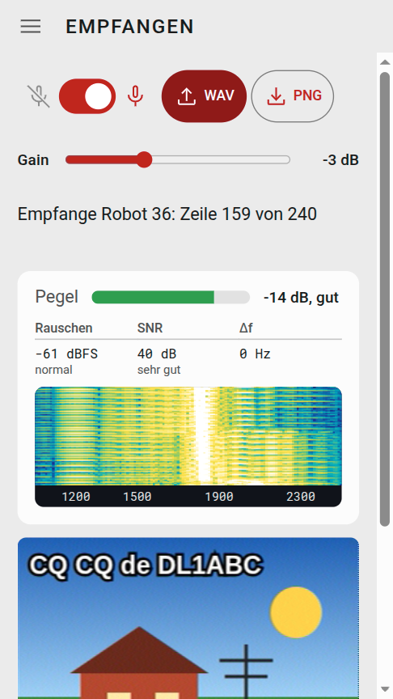
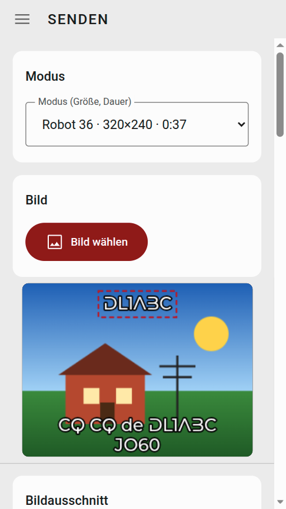
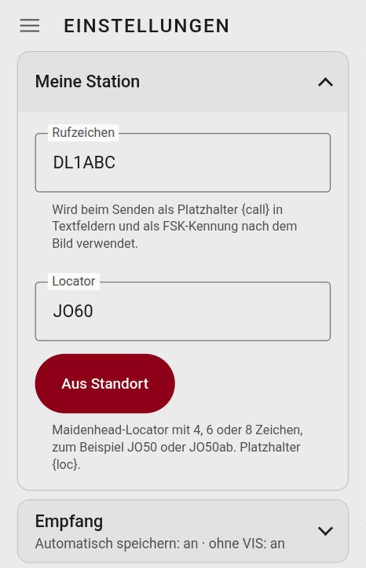
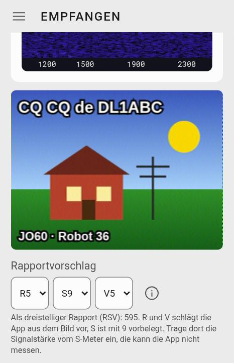
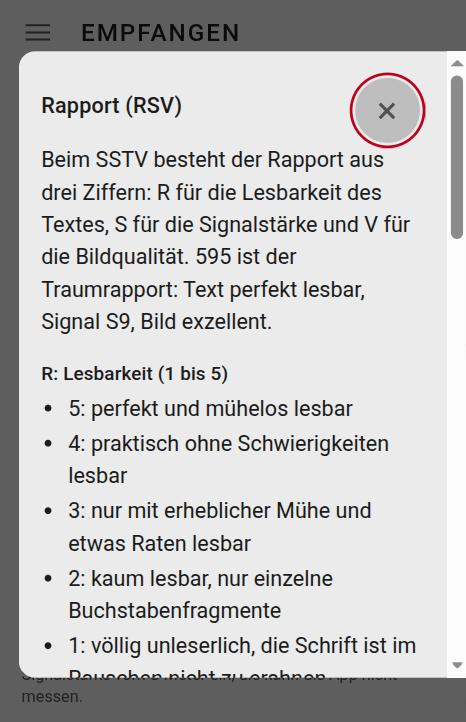
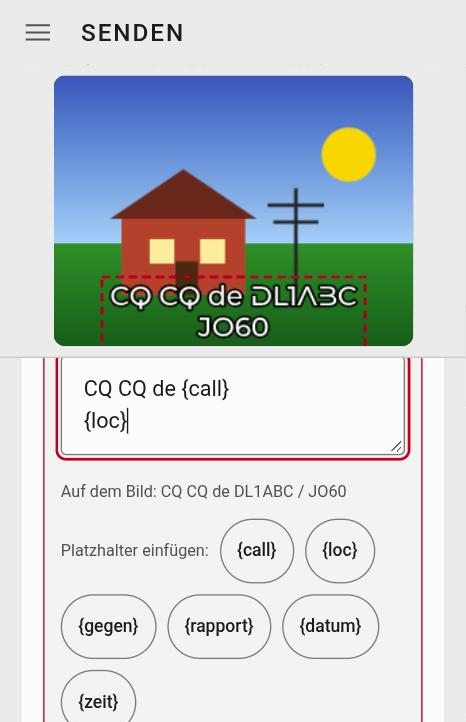
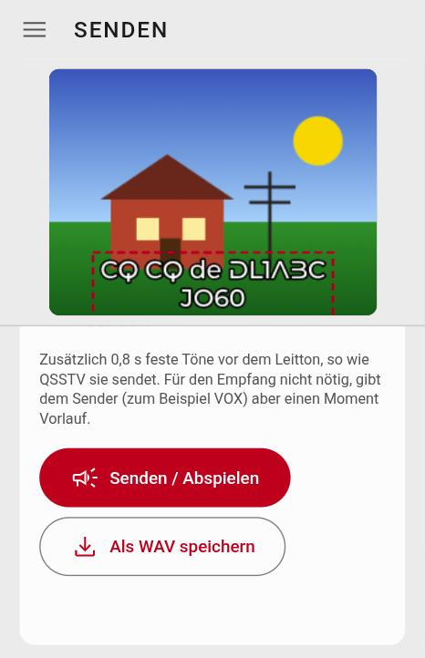
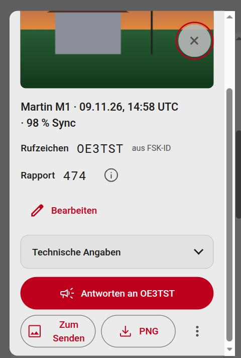
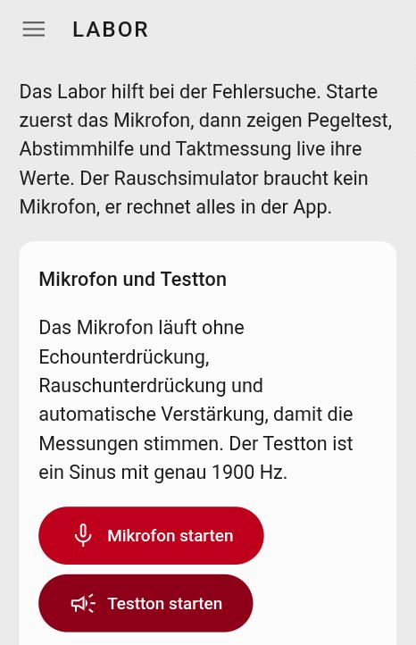
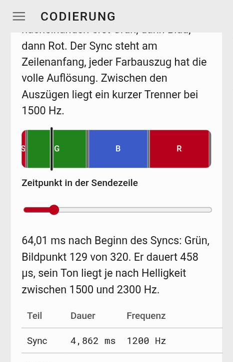

# SSTV-Horch: the guide

*A manual for an app that turns pictures into sound and back again.*

## What it is about

SSTV (Slow Scan Television) sends still pictures as sound over radio. The picture is turned into a tone frequency line by line: 1500 Hz means black, 2300 Hz white, with the greys and colours in between. Between the lines comes a short timing tone at 1200 Hz, which tells the receiver where a line begins. Depending on the mode, one picture takes from a little over half a minute to about four and a half minutes.

Because the signal needs only tones in the voice range, it fits through any voice radio. You hear it on shortwave and VHF, and the International Space Station sends such pictures to Earth on certain dates.

**SSTV-Horch** does both in the browser:

- **Receive:** Tones from the microphone, from a WAV file or from a WebSDR are turned back into a picture. The app recognises the mode by itself, even if the start of the transmission is missing.
- **Send:** A picture, a camera shot or a photo from the gallery is cropped, given text and played as an SSTV signal or saved as a WAV file.
- **Besides that:** a gallery for everything you have received, a small logbook, a lab for measuring and trying things out, and a page that explains how the signal is built.

Thirteen modes are built in, from the fast Robot 36 (36 seconds) to the slow Scottie DX (a little over four and a half minutes). Everything runs on your device. There is no account, nothing is uploaded, and after the first load the app also works without a network.

## How it came about

SSTV-Horch is the sister of [FT8-Horch](https://ohrenbeisser.de/app/FT8-horch/) and works in a similar way: a menu at the top left, the areas inside it, light and dark appearance, German and English.

The physics, the modes and the troubleshooting are in the article [SSTV – Fernsehen im Schneckentempo](https://ohrenbeisser.de/sstv-fernsehen-im-schneckentempo/) (in German). The app is its counterpart: what the article explains (the line structure, the code at the start, the frequencies), you can listen to here, change and try out with your own pictures. The **Coding** area is made for exactly that.

## How to use this guide

- **In a hurry?** The next chapter, “The essentials in three minutes”, takes you to your first received and your first sent picture.
- **Looking something up:** The chapters follow the items in the menu (Receive, Send, Gallery, WebSDR, Lab, Coding). At the end there is a “When nothing works” table and a small glossary.
- **The examples** use made-up callsigns such as `DL1ABC`.

## The essentials in three minutes

Not in the mood for manuals? Understandable. Here is the short version, first for receiving, then for sending.

### Receive a picture

1. Open the menu (☰) at the top left, choose **Settings** and enter your callsign and your locator (for example `DL1ABC` and `JO60`). You do not need this for receiving yet, but it is handy later for sending and for the logbook.
2. Open **Receive** in the menu. Slide the **microphone switch** (microphone crossed out on the left, microphone on the right) to the right and answer the microphone question with “Allow”.
3. Make an SSTV transmission audible: from the speaker of a radio or receiver, from a WebSDR, or from a second device running SSTV-Horch. The microphone should be about 20 to 50 cm from the speaker. The **Level** bar shows how loud it arrives: green means good, yellow too low or high, red clipping. The word is always next to it.
4. As soon as the code at the start is recognised, the top shows something like “Receiving Robot 36: line 159 of 240” and the picture grows line by line. At the end it says “complete” and “Saved to the gallery”. If the sender also sent their callsign (FSK ID), the app shows it.
5. Under the picture the app suggests a **report**: R (readability) and V (picture quality) from the picture, S (signal strength) preset to 9. You can change all three.

### Send a picture

1. Open **Send** in the menu and choose the **mode** at the top. Robot 36 is a good start: 37 seconds, 320 × 240 pixels.
2. Press **Choose image** (on a phone also **Take photo**). The picture appears in the frame. Move it with one finger, zoom with two.
3. With the quick choices **Callsign** and **CQ call** you place text fields in the picture. Drag them into position with your finger.
4. Further down you set the **output level** and press **Send / Play**. A red line moves across the preview and shows how far the picture has got. Set the volume on the device so that the transmitter does not overdrive.

### Try it without radio

You do not need a radio to see whether everything works:

- **With a file:** In **Send** press **Save as WAV**. Then in **Receive** choose **Load WAV** and open the file. The app decodes its own signal in a few seconds.
- **With two devices:** One device sends, the other listens with its microphone. More on that in a later chapter.

## What SSTV-Horch can do (and what it had better not)

### The areas in the menu

| Area | What for |
|---|---|
| **Receive** | Listen to SSTV and see it as a picture: microphone, WAV file or WebSDR audio, with waterfall, level and a suggested report |
| **Send** | Choose a picture, crop it, add text, play it as sound or save it as WAV |
| **Gallery** | everything received, with filter, callsign and report, backup as ZIP, plus the logbook |
| **WebSDR (Beta)** | servers on the net whose audio the app can listen to like a microphone |
| **Coding** | three cards that show and let you hear how the signal is built |
| **Lab** | level test, tuning aid, clock measurement, noise simulator |
| **Settings, Help, About** | station, audio devices, language and appearance, this guide, licence and privacy |

### The thirteen modes

SSTV-Horch knows these modes, for sending and for receiving:

| Mode | Picture size | Duration (with lead-in) | VIS |
|---|---|---|---|
| Robot 36 | 320 × 240 | 0:37 | 8 |
| Robot 72 | 320 × 240 | 1:13 | 12 |
| Martin M1 | 320 × 256 | 1:55 | 44 |
| Martin M2 | 320 × 256 | 0:59 | 40 |
| Scottie S1 | 320 × 256 | 1:51 | 60 |
| Scottie S2 | 320 × 256 | 1:12 | 56 |
| Scottie DX | 320 × 256 | 4:30 | 76 |
| PD90 | 320 × 256 | 1:31 | 99 |
| PD120 | 640 × 496 | 2:07 | 95 |
| PD160 | 512 × 400 | 2:42 | 98 |
| PD180 | 640 × 496 | 3:08 | 96 |
| PD240 | 640 × 496 | 4:09 | 97 |
| Wraase SC2-180 | 320 × 256 | 3:03 | 55 |

The **VIS number** is the code with which a sender announces the mode. More on that in the “Coding” chapter.

What each mode is good for:

- **Robot 36** is the quick start and at home on 2 m (FM) and with the ISS. On shortwave it is more prone to tuning errors. Robot 72 takes twice as long, and each line carries its own colour information.
- **Martin M1** is the most popular mode on shortwave according to the SSTV Handbook. **Martin M2** is half as long and helps on unsettled bands.
- **Scottie DX** is meant for long-distance contacts and takes a little over four and a half minutes. **Scottie S2** is the fast variant, S1 lies in between.
- **PD90 to PD240** are the high-resolution modes (PD120, PD180 and PD240 with 640 × 496 pixels). Two picture lines share the colour information. The ISS sometimes sends PD120.
- **Wraase SC2-180** is an RGB mode with three colour channels per line and no separators between them.

### What the app does by itself

- **Recognise the mode:** from the VIS code at the start. If it is missing (start missed, lost in the noise), the app looks for the timing of the lines. It recognises fast modes after a few seconds, Scottie DX and PD180 need 20 to 25 seconds.
- **Compensate frequency offset**, even if it drifts during the picture.
- **Compensate the clock error of the sound card**, otherwise the picture stands crooked.
- **Read the callsign** if the sender sends it as an FSK ID after the picture.
- **Partial pictures** are saved and marked when a picture breaks off.

### What it had better not

- **No iPhone and no iPad.** The app is built for Android with Chrome and for the computer.
- **Analogue SSTV only.** Digital picture modes such as DSSTV (HamDRM) are beyond the app.
- **No radio control.** There is no CAT and no PTT switching. To transmit you switch by VOX or by hand.
- **No pass predictor.** Other tools tell you when the ISS flies over. For Doppler there is a note in the “WebSDR (Beta)” chapter.
- **It cannot read the S-meter.** The app only hears the audio behind the receiver, not the field strength at the antenna. That is why S in the report is preset to 9 and you enter the value.
- **A good signal-to-noise ratio (SNR) is no guarantee for a good picture.** It only measures signal against noise. Distortion and echo, for example over speaker and microphone, it does not see.
- **Without VIS the start of the picture is estimated.** You can move it by hand in the gallery. With very strong frequency offset (above about ±140 Hz) the app does not find the timing without VIS.
- **The audio of a browser tab** (for WebSDR) works only in Chrome and Edge on a computer.
- **Transmitting by radio** requires an amateur radio licence. For practice a file, a cable or speaker and microphone are enough.

### Where the app runs

| Device | Status |
|---|---|
| Android with Chrome | tested (Pixel 10a) |
| Linux computer with Chrome | tested |
| Windows and Mac with Chrome or Edge | not tested specifically, should work |
| Firefox on a computer | not tested, no tab audio |
| iPhone and iPad | not planned |

The microphone and installing as an app need a **secure connection** (HTTPS). Through the app's web address that is given.

## First steps

### Callsign and locator

Menu (☰), **Settings**, section **My station**. There you enter your **callsign** and your **locator**.

- The app inserts the **callsign** for the placeholder `{call}` in text fields and, if you wish, sends it as an FSK ID after the picture. Letters, digits and the slash are allowed, 3 to 12 characters. The app only warns if it does not look like a callsign, it blocks nothing.
- The **locator** (Maidenhead, 4, 6 or 8 characters, for example `JO50` or `JO50ab`) stands for the placeholder `{loc}`. The **From location** button works it out from your device's position. For that the browser asks for permission to locate you. The app does not store the position itself.

### Audio devices

In the section **Audio devices** you choose which microphone (or audio input) and which speaker (or audio output) the app uses. The choice applies to Receive, Send, Lab and the audio samples.

1. Press **Show devices**. The browser shows the names of the devices only once you have allowed microphone access. The app releases the microphone again at once.
2. Choose the input and the output. A **USB sound card** or a **virtual audio cable** appears here as a device. That is how you connect a radio with a sound card or a second program on the same computer.
3. If the chosen device is missing later, the app takes the system's default device.

Firefox cannot switch the output. There you set it in the system.

When recording, the app switches off echo cancellation, noise suppression and the microphone's automatic gain itself. They would distort the tones on which the picture rests.

### The time display

Unlike modes with fixed time slots, the clock does not have to be right to the second with SSTV. It only determines how times appear. In the section **Language, appearance and time** you choose under **Time display** between **Local time** and **UTC**. This applies to the gallery, the file names and the placeholders `{datum}` and `{zeit}`. With UTC the word “UTC” is added. The logbook always keeps time in UTC.

There you also set the **language** (German or English) and the **appearance** (**Light**, **Dark** or **System**).

### Back up your data

Everything the app stores stays on your device: pictures and logbook in the browser's storage, settings next to it. If you delete the browser data, it is gone. So:

- In the **Gallery**, **Backup (ZIP)** creates a file with all pictures, their callsign and report, the raw recordings and the logbook. **Restore backup** brings it back. What is already there, the app skips. The settings are not in the backup.
- At the bottom of the gallery the **Storage** card shows how much space the pictures take. If storage is not persistent, the browser may clear it when space runs short. **Request persistent storage** asks the browser for that.

### As an app on the home screen

SSTV-Horch can be installed like an app. It then starts in its own window and also works without a network.

- From the third start a bar at the top asks whether you want to install (**Install** or **Not now**). You can also do it at any time in the settings under **Installation**.
- If the button does not work, the browser menu has “Install app” or “Add to home screen”.
- Installing works only over a secure connection (HTTPS).

When a new version of the app arrives, it reloads itself. If a reception or playback is running, it waits until both are over.

## Receive

### Microphone, gain and level

At the top of the **Receive** area sit the **microphone switch**, **WAV** (load a WAV file), **PNG** (save the picture) and the **Gain** slider. On narrow screens the gain moves below the buttons.

- **Microphone switch:** right is on. While it is off, a veil lies over the readings card, because there is nothing to measure.
- **Gain** amplifies inside the app, from −20 to +30 dB. It works behind the microphone and cannot undo clipping in front of it. First set the volume at the source properly, use the gain only for fine-tuning.
- The **Level** bar shows the peak of the signal in dB and a word:
  - **too low** (yellow): peak below about −30 dB. Turn it up or raise the gain.
  - **good** (green): between about −30 and −6 dB. Aim for peaks around −20 to −6 dB.
  - **high** (yellow): between −6 dB and just under 0 dB. Not clipping yet, but little headroom. Turn it down a step.
  - **clipping** (red): the peak reaches the limit (0 dB), the signal is cut off. Turn it down.
- While the microphone runs, the screen stays on. If you switch to another area for a moment, reception continues and nothing is lost.

### Readings and waterfall

Under the level there are three readings:

| Reading | Meaning |
|---|---|
| **Noise** | noise floor in dBFS: below −70 “very quiet”, up to −55 “normal”, above that “loud” |
| **SNR** | signal-to-noise ratio in the tone band: from 30 dB “very good”, from 20 “good”, from 12 “picture gets grainy”, from 6 “very weak”, below that “no signal” |
| **Δf** | frequency offset in Hz. The app compensates it. From about 40 Hz the word “large” appears next to it: then the receiver is tuned too far off |

The noise floor is the quietest value of the last 90 seconds. While a picture runs, no new measurement is added, so the value from before the picture stays. If you move the gain, the measurement starts afresh.

The **waterfall** shows frequency to the right (1000 to 2500 Hz) and time downwards. The marks mean: 1200 Hz timing (sync), 1500 Hz black, 1900 Hz leader tone, 2300 Hz white. Noise stays dark blue. Before a picture you see the leader tone as a bright vertical line at 1900 Hz, a picture itself fills the whole band between 1500 and 2300 Hz.

### How the app recognises a picture

- **With header:** An SSTV picture starts with a leader tone and the **VIS code**, which gives away the mode. Once the app has heard it, the top says “Receiving Robot 36: line 159 of 240”.
- **Without header:** If the start is missing, the app looks for the timing of the lines. It recognises fast modes after a few seconds, slow ones such as Scottie DX and PD180 need 20 to 25 seconds. Then it also says “Detected from the line timing without a VIS header, the top of the picture may be shifted”. You can switch this off in the settings under **Receive** (**Detect pictures without a VIS header**). It costs some computing time and about 6 MB of memory.
- **Discarded:** If the app finds a header but no usable signal after it, it says “Header for … found, but no usable signal. Discarded.”
- **Incomplete:** If a picture breaks off or you switch the microphone off, the app saves the partial picture and writes “incomplete: 120 of 240 lines”.
- **Callsign:** If the sender sends an FSK ID after the picture, the app reads it and writes “Callsign (FSK ID): DL1ABC”. If the checksum is wrong, a question mark follows, and the app does not enter the callsign.

### The finished picture

When the picture is complete it says “complete” and “Saved to the gallery”. Saving is a switch in the settings under **Receive** (**Save received images automatically**). If you tap the picture, it fills the screen, a second tap takes you back. **PNG** saves it as a file.

Robot 36 and the PD modes send brightness and colour in the “studio range”. Other decoders show them flatter, with grey instead of black. The **Compatible brightness** switch in the settings shows them that way too, for comparison with other programs. It takes effect from the next reception and only for Robot 36 and the PD modes. Saved pictures stay unchanged.

### The suggested report

Under the picture is the **suggested report** with three selection fields. In SSTV the report is three digits, 595 in the example:

- **R** is the readability of the text (1 to 5),
- **S** the signal strength (1 to 9),
- **V** the picture quality (1 to 5).

After the picture the app measures how noisy it is and derives **R and V** from that. If many lines are missing, both values drop. It does not know **S**, because the field strength at the antenna is seen only by the receiver's S-meter. That is why S is set to 9 and you enter the value you read off. You can change all three fields. The change is carried over to the gallery.

The suggestion is an approximation. A photo with fine structure quickly counts as noisy, and the measurement does not see skew or colour errors. You decide. The **(i)** next to the fields opens an explanation with the steps for R, S and V.

### Raw recording and other sources

- **Raw recording:** With the switch **Keep the raw recording of received pictures** (settings, section **Receive**) the app attaches the recording (12 kHz, 16 bit, with a little lead-in) to every picture that comes in over the microphone. In the gallery you save it with **Raw WAV**. With it you can decode the picture again later, in **Receive** via **WAV** or with another program. Robot 36 needs about 1 MB for this.
- **WAV file:** **WAV** reads a file faster than real time and shows the picture. That suits recordings and trying things out.
- **Browser tab:** The audio of a WebSDR in the browser is taken over by the page **WebSDR (Beta)**. It also explains how.

### Tips for good pictures

- **Level green:** Watch the bar at the leader tone, not in the middle of the picture.
- **Distance and volume:** Over speaker and microphone they stand about 20 to 50 cm apart, with the speaker not at full volume. A cable is better (chapter “Over speaker and microphone, by cable or with the radio”).
- **Quiet room:** Conversations and noise disturb the band. The waterfall shows it.
- **Keep the app in the foreground** and the screen on. The app keeps it on itself while the microphone runs.
- **Crooked picture, wrong colours, noise:** The chapter “When nothing works” explains what is behind it.

## Send

### How the area is laid out

From top to bottom the **Send** area consists of these parts: **Mode**, **Image**, **Image section**, **Text** (with the **Details for your texts**), **Templates** and finally **Transmit**. The **preview** of the image to be sent stays at the top when you scroll and takes at most a third of the height. So you always see what you are editing.

### Mode and image

- **Mode (size, duration):** The list gives the picture size and duration for every mode, for example “Robot 36 · 320×240 · 0:37”. The frame in the preview adapts.
- **Choose image** opens a file or a photo from your device's gallery. **Take photo** exists only on devices with a camera and opens the camera app. A picture from the SSTV-Horch gallery you send here with **To Send** in the picture dialog.

### The image section

The image fills the frame of the mode only if the aspect ratios match. Otherwise you decide:

- **Fill** crops the image so that it fills the frame completely.
- **Fit** shows the whole image and fills the rest with **bars** in black, grey or white.
- With **one finger** you move the image in the frame, with **two fingers** or the mouse wheel you zoom. The **Zoom** slider does the same.

### Text in the picture

Under **Text** you place text fields on the image. The **quick choices** create them at the press of a button:

| Button | Text |
|---|---|
| **+ Text field** | an empty field |
| **Callsign** | `{call}` |
| **CQ call** | `CQ CQ de {call}` and `{loc}` in the second line |
| **QSO** | `{gegen} de {call}` and `UR RSV {rapport}` |
| **Locator** | `{loc}` |
| **Date and time** | `{datum}  {zeit}` |

The placeholders in curly brackets are filled in by the app when sending: `{call}` and `{loc}` from the settings, `{gegen}` and `{rapport}` from the **Details for your texts** (the other station's callsign and the report you give them), `{datum}` and `{zeit}` from the clock. A question mark in the report stands for the S that you enter yourself.

- You move a text field in the picture with your finger.
- If you tap a text in the **Texts on the image** list, the **editor** opens. There you change the text itself, the **font** (three fonts are included in the app, plus three system fonts), the **font size**, the **colour** (white, yellow, red, black) and the **outline**. The buttons under **Insert placeholder** put `{call}` and the others at the cursor. The line “On the image:” shows how the text looks after substitution.
- You delete a field with the bin. **Undo** brings it back.

### Templates

A **template** remembers the arrangement, size, colour and font of all texts including placeholders, not the image. That saves work if you often need the same layout.

- **Save:** Enter a name (up to 40 characters) and press **Save**. An existing name is overwritten. At most 20 templates are possible. With no text on the image there is nothing to save.
- **Load** puts a template on the image, **Delete** removes it. Both can be taken back with **Undo**.

### Transmitting

The **Transmit** part at the end has these settings:

- **Output level:** The slider lowers the volume of the signal further. The signal itself always has headroom (at most 80 % of full scale), so that the transmitter's final stage and level control are not driven into the wall. Set the volume on the device so that the transmitter does not overdrive. You can also change the level during playback.
- **Send callsign as FSK ID after the image:** After the picture your callsign follows as a short tone sequence (about 2 seconds extra). Receivers such as QSSTV and SSTV-Horch read it. Your callsign has to be in the settings for that.
- **Send calibration header before the leader tone:** An extra 0.8 seconds of fixed tones before the leader tone, as QSSTV sends them. Reception does not need them, but they give the transmitter (for example with VOX) a moment of lead-in.
- **Clock correction of this device:** If you measured your sound card's clock deviation in the lab and entered it in the settings, the app uses it when playing. Not for WAV files, because they may run on another device.

Then you press **Send / Play**. The app calculates the signal (“Calculating the signal …”) and plays it. The status line shows “Transmitting: 0:12, 0:25 left Line 80 of 240.”, and a **red line** moves across the preview and shows how far the picture has got. **Stop** cancels. During playback the screen stays on. You choose the output in the settings under **Audio devices**.

### Save as WAV

**Save as WAV** produces the same signal as a file (`sstv_robot36_…wav`), with the set output level. With it you can prepare a picture, take the file to another device or into a radio program and send it later. To try it out, load it in **Receive** via **WAV**.

## Gallery and logbook

### The grid

Everything you receive lands in the **Gallery**, partial pictures too (with a dashed border and “Partial 154/256”). Each tile shows the preview, the mode, the time and the quality of reception (share of lines with a sync hit, for example “98 %”).

, filtered by “TST”. The fourth picture is a partial one. The screenshot shows the German interface.")

- **Filter:** **Search** by callsign or mode, **Mode** and **Period** (All, Today, Last 7 days, Last 30 days). Above them it says “4 of 20 pictures”, **Reset filter** brings everything back.
- **Select** switches selection on. You tap pictures, **All** and **None** choose the ones currently shown, **Delete** asks once more (“Delete 3 for good?”), and **Back up selection (ZIP)** backs up only these pictures.

### The picture in detail

If you tap a tile, the picture opens. At the top are mode, time and the quality of reception, below them **callsign** and **report** as text.

- **Callsign:** Next to it is where it comes from: “from FSK ID” or “manual entry”. The **(i)** next to the report explains the steps.
- **Edit** opens the input field for the callsign and the three selection fields for R, S and V. **Save** applies, **Cancel** discards, the Enter key also saves. A callsign changed by you counts as a “manual entry”.
- **Technical details** (collapsed): mode with VIS number or “detected without VIS”, lines, shift, raw recording, source (microphone, WAV file, browser tab, backup) and size.
- **Reply to …** appears as soon as a callsign is there. The button jumps to **Send**, enters the other station and the report, preselects the mode and creates a QSO text. You choose the picture yourself.
- **To Send** sends this picture to **Send** as the picture to transmit. **PNG** saves it as a file, **Raw WAV** the raw recording (if there is one).
- The **⋮** menu offers **Share** (the device's share menu), **Add to log** and **Delete** (with a second tap, “Really delete?”).

**Shift picture start** appears for pictures that were detected without VIS. There the start is only estimated: the first line heard counts as the top. With the slider (and the buttons −10, −1, +1, +10) you shift the picture down (positive values, the top stays empty) or up (negative values). **Apply shift** saves, **Restore original** goes back. The original is always kept.

### The logbook

Under the grid is the **Log (n)** card for your QSOs.

- **New entry** opens a form: callsign, date and time (UTC), mode, RSV sent and received, band, frequency in MHz, name, locator and note. The app checks callsign, locator and time.
- **Add to log** in a picture's menu pre-fills the form: callsign, mode, time and the report from the picture. This report is the one you give the other station, it goes under “RSV sent”. What the other station gives you, you enter under “RSV received”.
- **Export ADIF** produces a file for your station log, **Export CSV** a semicolon table that opens directly in German Excel and LibreOffice. The time is always in UTC.
- The entries live in this browser. The full **Backup (ZIP)** of the gallery includes the logbook.

## Over speaker and microphone, by cable or with the radio

### Two devices through the air

The simplest setup: one device plays the signal, the other listens with its microphone. That is how the app's milestone worked, with a phone and a laptop.

- **Distance:** 20 to 50 cm between speaker and microphone.
- **Volume:** A phone microphone is sensitive. The laptop should not play at full volume (about 20 to 50 %). In our tests the laptop microphone was too sensitive at 100 %, 30 to 40 % worked better.
- **Room and screen:** A quiet room, and the screen of the receiving device stays on.
- **Check the level:** With a good setup the level reads “good” (green). Watch it at the leader tone.
- **What to expect:** Through the air you get a picture with noise that can still be quite readable. Distortion and echo of the room disturb more than the signal-to-noise ratio reveals (see the chapter “What SSTV-Horch can do”). A cable is better.

### By cable or virtual cable

A cable from the headphone socket of one device to the microphone or line input of the other avoids room and noise. The same works without a cable inside a computer with a **virtual audio cable**: one program passes the sound of one program to the input of another. On Linux you get that with PipeWire or PulseAudio, on other systems as separate programs. The cable appears in SSTV-Horch under **Settings**, **Audio devices** as an input and as an output (see “First steps”). That is how the cross-check with QSSTV was done on one computer (see “The cross-check with QSSTV”).

A **USB sound card** also appears there as a device.

### With the radio

The app does not control your radio (no CAT, no PTT switching). It only delivers and hears sound.

- **Receiving:** Connect the receiver's audio output (speaker or headphone output, on some radios a data socket) to the audio input of the computer or phone, or let the app listen through the speaker with the microphone. Tune the receiver so that the leader tone sits at 1900 Hz: the **tuning aid** in the lab shows the deviation, so does **Δf** in “Receive”. On shortwave use the lower sideband (LSB) below 10 MHz, the upper (USB) above.
- **Transmitting:** The app's output goes to the transmitter's microphone or data input. The output always has headroom (at most 80 % of full scale). Set the **output level** and the transmitter's microphone gain so that the transmitter's ALC does not respond. If you switch by **VOX**, the **calibration header** gives the transmitter a moment of lead-in, otherwise you switch by hand.
- **Callsign:** The **FSK ID** after the picture states your callsign in the signal. Your callsign also belongs in the picture as a text field.
- **Responsibility:** Callsign, frequency, transmit power, band plan and the terms of your amateur radio licence are your business. The app does not switch a radio.

## WebSDR (Beta)

### What the page is for

A **WebSDR** (also KiwiSDR or OpenWebRX) is a receiver on the net that you can listen to in the browser. The **WebSDR (Beta)** page takes the audio of such a browser tab and feeds the decoder in **Receive** with it, like a microphone.

 page: button for tab audio and the collapsible sections, below them the server list. The screenshot shows the German interface.")

### How to proceed

1. Open one of the servers from the list at the bottom of the page. The link opens in a **new tab**. With the **(i)** you see location, coverage and the address.
2. Set the frequency and sideband there (for example 14.230 MHz, USB) and start the audio.
3. Come back to SSTV-Horch and press **Use audio from a browser tab**. In the dialog choose the server's tab and keep **Share tab audio** ticked.
4. SSTV-Horch switches to **Receive** and decodes. The tab has to stay open and must not be muted. If you end sharing in the browser, the app stops. The switch in “Receive” then says “Stop tab audio”.

### Where SSTV is sent

The page has two collapsible sections: **How it works** and **Where is SSTV sent?** The second holds the meeting points on shortwave (3.735 and 7.165 MHz LSB, 14.230, 21.340 and 28.680 MHz USB), VHF, the space station ISS with its frequency and the Doppler shift, alternative frequencies, which mode is usual where, and the repeaters. This guide does not repeat that but points to it.

### Limits and manners

- The audio of a browser tab works **only in Chrome and Edge on a computer**. On a phone and in Firefox the button is switched off, with a short note. There the way through speaker and microphone remains.
- The servers belong to other people. Be considerate to the operators and do not leave the connection running for hours. Some servers allow only a limited number of listeners. Whether a server is reachable right now, you only see when you open it.
- The server list is a suggestion as of 9 November 2026. Servers come and go.
- A WebSDR delivers no SSTV when nobody is transmitting. Try at the times and on the frequencies given on the page.

## Lab

The **Lab** helps with troubleshooting and trying things out. Start the microphone first, then level test, tuning aid and clock measurement show their values live. The noise simulator needs no microphone.

### Microphone and test tone

**Start microphone** opens the microphone without echo and noise suppression and without automatic gain, so that the measurements are right. **Start test tone** plays a sine of exactly 1900 Hz. You need the test tone for the clock measurement and for the distance to the noise floor. Keep its volume moderate, 20 to 40 % is usually enough.

### Level test

Shows how hard the microphone signal is driven: the current peak, the highest peak, the effective value, the number of overdriven samples and the noise floor (the quietest moment of the last 10 seconds). If a steady tone lies in the band, the noise floor is left out. With the app's own test tone it shows the distance of the test tone to the noise instead. For SSTV a peak of about −20 to −6 dBFS is good. The bar has the same colours and words as in “Receive”, with a note on what to do.

### Tuning aid (tone correction)

Measures the frequency of the strongest tone and shows by how many Hz it differs from the chosen **target tone**. The tones of the signal are available as target tones, above all the leader tone at 1900 Hz. On air, tune the receiver so that the leader tone sits at 1900 Hz. That also removes the colour cast in Robot and PD. In USB the tone drops when you raise the receive frequency. Up to 5 Hz of deviation counts as “fine”.

### Clock deviation of two devices

Measures how far the clocks (sampling rates) of two devices drift apart. The skew of the lines comes from that.

1. **Device A** plays the test tone (**Start test tone**).
2. **Device B** listens with its microphone and presses **Start measurement**. After about 10 seconds a value appears, after a minute it is accurate.
3. The result is in ppm with uncertainty and spread. Positive means the clock of device A runs faster than that of B.
4. **Use as correction for this device** enters the value in the settings (section **Send**), and the app compensates it when playing. That is right only if device A keeps good time, for example a PC with a good clock. If A is itself inaccurate, its error ends up in your correction.

If the test tone runs on the same device that records, you see almost 0, a self-test. The tuning error of receivers on air this card does not measure, that is what the tuning aid is for.

### Noise simulator

Encodes a test picture (or your own), adds noise, tuning error and clock error and decodes it with the app's decoder. That shows how much interference a mode can take. You set **Mode**, **Signal-to-noise ratio in the SSTV band**, **Tuning error** and **Clock error** and press **Simulate**. **Compare all modes** calculates all thirteen one after the other and shows a table with error, quality and result. The signal-to-noise ratio refers to a band of 2400 Hz, about the width of an SSTV channel. On real radio paths interference is distributed differently (fading, impulse noise). The simulator is a comparison tool, not a copy of reality.

## Coding

The **Coding** area shows how an image becomes a sound. The app calculates all numbers and graphics from the mode table and the encoder, so they match what is really generated when you transmit. The **mode** at the top applies to all three cards. The **listening samples** let you hear the tones.

### Line structure

An SSTV picture is sent line by line. Every transmit line starts with a short sync pulse at 1200 Hz, then the picture points follow as tones. How the colours are packed depends on the mode. The card shows the line as a coloured bar (for Martin, for example: green, blue, red one after the other). With the **Point in time within the line** slider you walk through the line and see which picture point and which colour channel is on and how long it lasts. A table gives the parts with duration and frequency. **Listen to two lines** plays them.

### Frequency and brightness

Every brightness has its tone, like the keys of a piano. Black sends 1500 Hz, white 2300 Hz, and the frequency rises evenly in between. The 800 Hz span is divided into 256 steps, about 3.1 Hz each. The sync at 1200 Hz is lower than any black, so the receiver cannot confuse it with a picture point. With the slider you set a brightness and hear the **tone** for it.

### The VIS code

Before the picture, the signal tells which mode follows: the VIS code (Vertical Interval Signaling). It consists of a leader tone at 1900 Hz, a short break at 1200 Hz, another leader tone and ten bits of 30 ms each. A 1 sounds at 1100 Hz, a 0 at 1300 Hz, and start and stop bit are at 1200 Hz. The card shows the bits of the chosen mode and the order in which they are sent (least significant bit first). **Listen to the preamble** plays leader tone and code. The physics behind it is explained in the article [SSTV – Fernsehen im Schneckentempo](https://ohrenbeisser.de/sstv-fernsehen-im-schneckentempo/) (in German).

## The cross-check with QSSTV

Anyone who wants to hold SSTV-Horch against another program takes **QSSTV**, the free SSTV program for Linux. That was checked on 7 November 2026 with QSSTV 9.5.8, on one computer over a virtual audio cable.

- **Result:** QSSTV reads all thirteen modes that SSTV-Horch produces. The FSK ID and the calibration header arrive too. Conversely SSTV-Horch decodes what QSSTV sends (Robot 36 and 72, Martin M1, Scottie S1, PD90, PD120 and Wraase SC2-180), callsign included.
- **Switch on “Auto Slant”:** Without this setting in QSSTV, QSSTV shows even clean signals crooked, with ours as with the signal of a foreign encoder. The clock on the cable measures 0 ppm. So the skew does not come from the signal.
- **QSSTV sends a little too fast:** The clock of QSSTV runs 56 to 95 ppm faster, depending on the mode. The decoder of SSTV-Horch compensates it.
- **Brightness:** QSSTV makes Robot and PD about 5 steps brighter on average than the original, SSTV-Horch is at 0 to 1. That is the Compatible brightness that you can switch on in the settings (see “Receive”).
- **When sending from QSSTV** the audio target must be set before the start, otherwise the head (leader tone, VIS) is missing, and SSTV-Horch says “without VIS”.
- **Small things:** With Scottie S2 the picture sits a few pixels sideways in QSSTV, whether that is QSSTV's doing is open. QSSTV hung when loading some foreign Scottie WAV files.

## When nothing works

| What you see | What helps |
|---|---|
| **“The microphone needs a secure connection”** or no microphone prompt | The app has to run over HTTPS (or over `localhost`). Also check the microphone permission for the page (padlock next to the address). |
| **Level yellow (“too low”) or red (“clipping”)** | Change the volume at the source, use the gain only for fine-tuning. See “Receive”. |
| **Picture noisy or streaky** | Check level and distance (20 to 50 cm, do not turn the speaker up fully), quiet room, better a cable. |
| **Picture skewed (“slant”)** | The sound card runs inaccurately. When receiving, the app compensates. When sending, measure the clock in the lab and enter it as a correction. QSSTV shows a clean signal skewed when “Auto Slant” is off. |
| **Colours wrong, pink or green (Robot, PD)** | The receiver is tuned off. Bring the leader tone to 1900 Hz with the tuning aid. Check the sideband (LSB below 10 MHz, USB above). |
| **No picture despite signal** | If the VIS code is missing, “Detect pictures without a VIS header” helps (settings, Receive). Slow modes need 20 to 25 seconds. With an offset above about ±140 Hz the app does not find the timing without VIS: tune first. |
| **“Header for … found, but no usable signal. Discarded.”** | The start arrived, but not enough signal after it. Try again louder, closer or without interference. |
| **Picture start shifted, something missing at the top** | With pictures without VIS the start is estimated. In the gallery use **Shift picture start**. |
| **Good SNR, yet an unusable picture** | The SNR sees only noise. It does not see distortion and echo (speaker and microphone). Better a cable. |
| **Picture looks flat, black is grey (compared with other programs)** | The other program takes Y directly as brightness. **Compatible brightness** in the settings shows it the same way. |
| **Tab audio does not arrive** | In the selection dialog choose a **tab** (not a window) and tick **Share tab audio**. The tab must not be muted. Only Chrome and Edge on a computer. |
| **My picture arrives crooked at the other end** | Measure the device clock in the lab and enter it as a correction under Settings, Send. |
| **The chosen microphone is not found** | The app takes the default device and says so. Choose the device again in the settings under **Audio devices**. |
| **Pictures are gone** | Browser data deleted? Then only a backup (ZIP) helps. Make one regularly and ask for **persistent storage**. |
| **Old version of the app** | Close the page and open it again. Under “About” “Loaded files” shows the version number. It reloads itself, but waits while a reception or playback is running. |

## A small SSTV glossary

- **Centre of activity:** agreed meeting point on a band (not a reserved channel), for example 14.230 MHz.
- **ARISS:** amateur radio on the International Space Station. During announced events it sends SSTV pictures.
- **Auto Slant:** a setting in QSSTV that straightens skewed pictures automatically.
- **Break:** short tone at 1200 Hz in the VIS code between the two leader tones.
- **CQ:** a general call to everyone who is listening.
- **DSSTV:** digital SSTV (HamDRM). The app cannot do it.
- **Doppler:** shift of the frequency when transmitter and receiver move, for example with the ISS.
- **FSK ID:** the callsign as a short tone sequence after the picture.
- **Gain:** amplification of the input signal in the app.
- **Calibration header:** fixed tones before the leader tone that some programs send (for example QSSTV). They give a transmitter lead-in.
- **Leader tone:** tone at 1900 Hz before the code.
- **Locator:** grid square (Maidenhead) that describes a location briefly, for example `JO60`.
- **LSB and USB:** lower and upper sideband. Below 10 MHz you use LSB, above it USB.
- **Level:** volume of the signal (here the peak in dB against full scale, dBFS).
- **PD modes:** high-resolution modes in which two picture lines share the colour information.
- **ppm:** parts per million. A measure for the deviation of a sound card's clock.
- **QSO:** a radio contact.
- **QSY:** change to another frequency.
- **Report (RSV):** three digits: readability R (1 to 5), signal strength S (1 to 9), picture quality V (1 to 5).
- **Pink-green trap:** colour cast in Robot and PD when the receiver is tuned off.
- **Skip zone:** dead zone around a shortwave transmitter in which you do not hear it although it transmits.
- **Slant:** skew of the picture caused by a clock error.
- **SNR:** signal-to-noise ratio, signal against noise.
- **Sync:** timing pulse at 1200 Hz at the start of a line.
- **VIS:** code at the start that gives away the mode.
- **VOX:** the transmitter switches to transmit by itself as soon as it hears sound.
- **Waterfall:** display of frequency and time from which you recognise a signal in the band.
- **WebSDR:** receiver on the net that you listen to in the browser.

## Licence, privacy and acknowledgements

### Licence and components

SSTV-Horch is under the **GPL-3.0-or-later**. You may use, change and pass it on, under the terms of the licence. The app contains: **Roboto** and **Roboto Mono** (SIL OFL 1.1), **Montserrat Alt1** (SIL OFL 1.1) and the **Material Symbols** (Apache 2.0). The details are also in the “About” area.

### Privacy

All data stays on this device. There are no accounts and no analytics. Pictures and recordings are stored locally in the browser only. The links on the “WebSDR” page lead to third-party servers, whose operators are responsible for their privacy. The audio you take over from there stays on your device.

### Liability

The app is provided without any warranty, as it is (see GPL-3.0, sections 15 and 16). The author is not liable for damage arising from its use. For radio operation you are responsible yourself: callsign, frequency, transmit power, band plan and the terms of your amateur radio licence. The app only sends sound through the speaker, it does not switch a radio.

### Acknowledgements

My thanks go to the developers of QSSTV and slowrx, whose free sources served as a reference for modes, timings and cross-checks, and to the authors of the MMSSTV documentation. Thanks also to everyone who makes fonts, symbols and tools freely available. The technology behind SSTV is explained by the blog article [SSTV – Fernsehen im Schneckentempo](https://ohrenbeisser.de/sstv-fernsehen-im-schneckentempo/) (in German) on ohrenbeisser.de.
